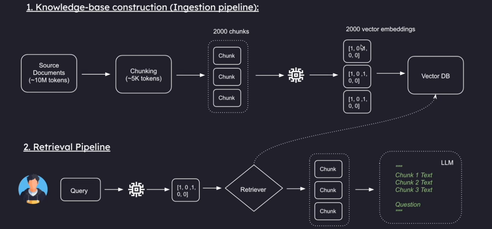
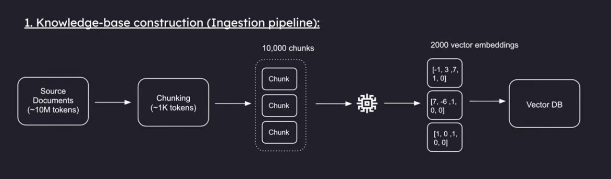
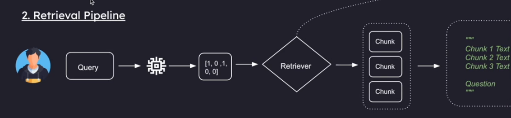
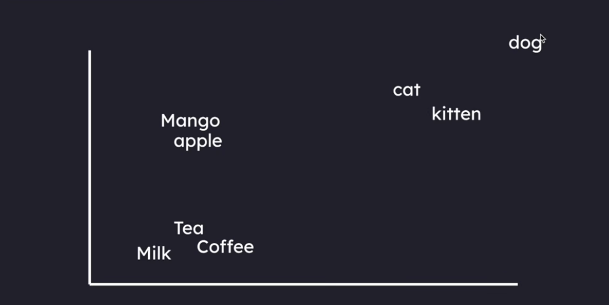
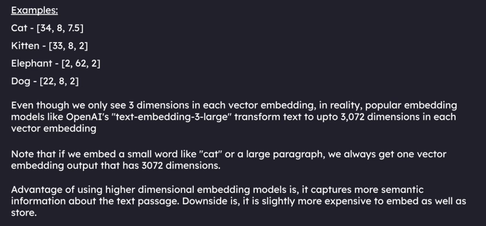
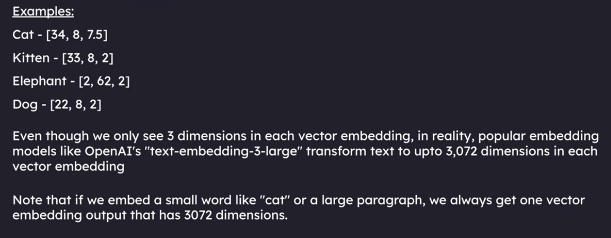
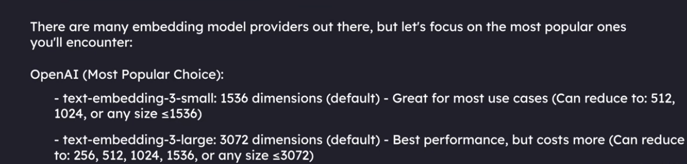
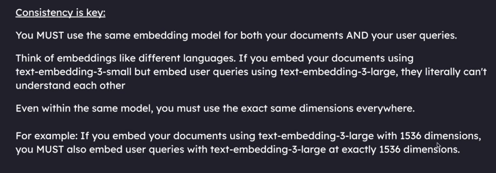

# RAG: Retrieval-Augmented Generation

> A super simple guide to understanding how RAG works - explained so easily that even a 5-year-old can understand it!

---



---

## 📚 Complete Learning Roadmap (Read in Sequence: 1 ➡️ 7)

All guides in this repository are numbered so you can follow them step-by-step:

| # | Guide Document | Topic Covered | Companion Code |
| :-: | :--- | :--- | :--- |
| **1** | [1_README.md](1_README.md) | **RAG Foundations & Architecture (ELI5)** | - |
| **2** | [2_INGESTION_README.md](2_INGESTION_README.md) | **Step 1: Document Ingestion Pipeline** | [`1_ingestion_pipeline.py`](1_ingestion_pipeline.py) |
| **3** | [3_RETRIEVAL_README.md](3_RETRIEVAL_README.md) | **Step 2 & 3: Retrieval & Generation Pipeline** | [`2_retrival_pipeline.py`](2_retrival_pipeline.py), [`3_retrival_pipeline.py`](3_retrival_pipeline.py) |
| **4** | [4_COSINE_SIMILARITY.md](4_COSINE_SIMILARITY.md) | **Math Deep Dive: Cosine Similarity & Vectors** | Used in Vector Search |
| **5** | [5_HISTORY_AWARE_GENERATION.md](5_HISTORY_AWARE_GENERATION.md) | **Step 4: History-Aware Multi-Turn RAG** | [`4_history_aware_generation.py`](4_history_aware_generation.py) |
| **6** | [6_RAG_CHUNKING_STRATEGIES.md](6_RAG_CHUNKING_STRATEGIES.md) | **All Chunking Strategies Compared** | Ingestion & Chunking |
| **7** | [7_CHARECTER_TEXT_SPLITTER.md](7_CHARECTER_TEXT_SPLITTER.md) | **CharacterTextSplitter Mechanics & Slides** | [`5_charecter_textSplitter.py`](5_charecter_textSplitter.py) |

---

## Table of Contents
- [What is RAG? (Explain Like I'm 5)](#what-is-rag-explain-like-im-5)
- [Real-World Example](#real-world-example)
- [Key Concepts Made Super Simple](#key-concepts-made-super-simple)
  - [1. What is a Token?](#1-what-is-a-token)
  - [2. What is a Context Window?](#2-what-is-a-context-window)
- [How RAG Works (Step-by-Step)](#how-rag-works-step-by-step)
  - [1. Knowledge Base Construction (Ingestion Pipeline)](#1-knowledge-base-construction-ingestion-pipeline)
  - [2. Retrieval Pipeline](#2-retrieval-pipeline)
- [Why is RAG so Great?](#why-is-rag-so-great)
- [Embeddings and Vector Databases](#embeddings-and-vector-databases)
  - [What is a Vector Embedding?](#what-is-a-vector-embedding)
  - [What is a Dimension?](#what-is-a-dimension)
  - [Real-World Dimensions](#real-world-dimensions)
  - [What is a Vector Database?](#what-is-a-vector-database)
- [Popular Embedding Models](#popular-embedding-models)
- [Consistency is Key!](#consistency-is-key)
- [Essential Libraries for Building RAG](#essential-libraries-for-building-rag)
  - [Installation Command](#installation-command)
  - [1. langchain](#1-langchain)
  - [2. langchain-community](#2-langchain-community)
  - [3. langchain-text-splitters](#3-langchain-text-splitters)
  - [4. langchain-openai](#4-langchain-openai)
  - [5. langchain-chroma](#5-langchain-chroma)
  - [6. python-dotenv](#6-python-dotenv)

---

## What is RAG? (Explain Like I'm 5)

Imagine you have a super smart robot friend named **LLM**. 
- The robot is very smart and loves answering questions, but it cannot remember every single book in the world.
- If you hand the robot a giant 1,000-page book all at once, its hands get full, its brain gets confused, and it drops the book!

**RAG is like giving your robot friend a helpful librarian helper:**
1. **R (Retrieval - Find it):** When you ask a question, the librarian quickly searches the library and finds only the exact 1 or 2 pages with the answer.
2. **A (Augmented - Add it):** The librarian gives those exact pages to the robot along with your question.
3. **G (Generation - Answer it):** The robot reads those few pages and gives you the perfect answer in simple words.

**Think of it like an Open-Book Exam!** Instead of memorizing every single book in the world, the robot just flips to the right page when you ask.

---

## Real-World Example

Imagine you work at a big company with **hundreds of files** (rules, technical guides, customer reviews, research papers, and reports).

- **Without RAG:** You try to dump all 500 files into the LLM at the same time. The LLM gets overloaded, slows down, costs a lot of money, or says: *"Sorry, this is too much text for me to read!"*
- **With RAG:** 
  1. You ask: *"What is our company's holiday policy?"*
  2. The **RAG system** quickly searches all documents and picks out just the 1 page about holidays.
  3. It hands that 1 page to the LLM along with your question.
  4. The LLM reads it and says: *"You get 15 days of vacation every year!"*

Everything is seamless, fast, and accurate!

---

## Key Concepts Made Super Simple

### 1. What is a Token?
- Think of words as small **LEGO blocks**.
- A **token** is a chunk of text processed by the LLM. It can be a whole word or just a piece of a word.
- For example, the word `"banana"` might be split into tokens like `"ba"` and `"nana"`.
- This means if you have a huge PDF that is **10 million tokens long**, you cannot feed it into the model all in one go!

### 2. What is a Context Window?
- The **context window** is like the robot's **reading desk**.
- It is the maximum amount of information (tokens) the LLM can hold and read at one time.
- If the desk only has room for 5 pages, you cannot dump a whole mountain of books on it.
- RAG makes sure we only place the most important pages onto the desk.

---

## How RAG Works (Step-by-Step)

### 1. Knowledge Base Construction (Ingestion Pipeline)
Before we can search anything, we need to organize our documents neatly in our library.



1. **Load:** Gather all your documents (PDFs, Word files, web pages).
2. **Chunk:** Chop big documents into small, bite-sized paragraphs.
3. **Embed:** Convert each paragraph into numbers (vectors) so the computer understands their meaning.
4. **Store:** Save them in a special database called a **Vector Database**.

> 📖 **Deep Dive:** Want to understand every single step and package of our code? Check out the [Ingestion Pipeline Guide](2_INGESTION_README.md)!

---

### 2. Retrieval Pipeline
When you ask a question, this pipeline springs into action to find the answer!



1. **Question:** You type your question.
2. **Search (Retrieve):** The system searches the vector database and finds the paragraphs most relevant to your question.
3. **Combine (Augment):** It puts your question and those relevant paragraphs together into one neat prompt.
4. **Answer (Generate):** The LLM reads the paragraphs and generates a clear, accurate answer!

> 🔍 **Deep Dive:** Want to understand every line of code, math concept, and parameter in our retrieval script? Check out the [Retrieval Pipeline Guide](3_RETRIEVAL_README.md)!

---

## Why is RAG so Great?
- **Accurate:** Stops the LLM from making things up (hallucinations).
- **Fast and Cost-effective:** Keeps prompts small so you do not waste time or money.
- **Always Up-to-Date:** When company documents change, just update the library without retraining the whole AI!

---

## Embeddings and Vector Databases

### What is a Vector Embedding?
Computers do not understand words like humans do. Computers only understand numbers!

A **vector embedding** turns words, sentences, or whole paragraphs into a list of numbers. 
Think of it like a **digital fingerprint** of what the words actually mean:
- Words with similar meanings get numbers that look very close to each other.
- Words with totally different meanings get numbers that are very far apart.

#### Simple Example:
- **Cat:** `[34, 8, 7.5]`
- **Kitten:** `[33, 8, 7.2]` (Notice how close these numbers are to Cat!)
- **Dog:** `[47, 8, 7.0]` (Still a furry pet, so some numbers match!)
- **Elephant:** `[2, 62, 85.0]` (A giant wild animal, so the numbers are totally different!)

### What is a Dimension?
Each number inside the list is called a **dimension**.

You can imagine each dimension as a mini-question about the word:
- Dimension 1: Is it small or big?
- Dimension 2: Is it a pet?
- Dimension 3: Does it live on land?

When we place these numbers onto a map (called multi-dimensional space), words that mean similar things sit right next to each other. On this map, the spot for **"Cat"** is right next to the spot for **"Kitten"**!





### Real-World Dimensions
In our toy example, we used only 3 numbers (3 dimensions). 

In real life, powerful embedding models (like OpenAI's `text-embedding-3-large`) give every word up to **3,072 dimensions**!



- Whether you turn a small word like `"cat"` or a huge paragraph into an embedding, you always get **one list of 3,072 numbers**.

---

## What is a Vector Database?
A regular database looks for exact word matches (like finding the exact letters "c-a-t").

A **Vector Database** stores vector embeddings (those lists of numbers). It searches by **meaning**, not just letters! 
- Even if you search for *"little fluffy baby cat"*, the vector database knows that the numbers match *"kitten"* and *"cat"*, and it finds the right document immediately!

---

## Popular Embedding Models
To convert our text into numbers, we use special tools called **Embedding Models**.



You can explore more details on embeddings here:
- [Voyage AI Embeddings Documentation](https://docs.voyageai.com/docs/embeddings)

---

## Consistency is Key!
When working with embeddings, you must always use the **exact same model** for storing documents and for searching questions.



- **Why?** Each model creates its own unique number map.
- If you use Model A to turn your documents into numbers, you **must** also use Model A when turning the user's question into numbers.
- If you mix two different models, their maps will not match, the numbers will point to the wrong places, and the system will give you the wrong answer!

---

## Essential Libraries for Building RAG

To build our RAG system in Python, we use a team of special tools. Here is what each tool does in simple words:

### Installation Command

Run this command inside your terminal:

```bash
pip install langchain langchain-community langchain-text-splitters langchain-openai langchain-chroma python-dotenv
```

---

### 1. langchain
- **What it is:** The Master Conductor (Connecting everything together).
- **Explain Like I'm 5:** Imagine you have toy train tracks. The tracks connect the engine, the wagons, and the station so they run smoothly together. `langchain` is the track that connects your questions, your document searcher, and the AI robot so they work together as one happy team.
- **Simple Example:**
  ```python
  from langchain_core.prompts import PromptTemplate

  # Helps frame the question and pass it to the AI
  prompt = PromptTemplate.from_template("Answer based on: {context}\nQuestion: {question}")
  ```

---

### 2. langchain-community
- **What it is:** The Universal Tool Bag (Loaders and Integrations).
- **Explain Like I'm 5:** If your robot wants to read a story from a PDF, a Word file, a website, or Wikipedia, it needs different pairs of reading glasses. `langchain-community` gives your robot glasses for almost any file format in the world!
- **Simple Example:**
  ```python
  from langchain_community.document_loaders import TextLoader, PyPDFLoader

  # Reads a text file or PDF from your computer
  loader = TextLoader("story.txt")
  documents = loader.load()
  ```

---

### 3. langchain-text-splitters
- **What it is:** The Document Scissors (Smart Chunking).
- **Explain Like I'm 5:** If you are given a giant sandwich, you cannot eat it in one whole bite. You cut it into small, neat slices. If a book has 200 pages, this library cuts the text into bite-sized paragraphs so the AI never gets full or confused.
- **Simple Example:**
  ```python
  from langchain_text_splitters import RecursiveCharacterTextSplitter

  # Cuts long documents into small pieces of 500 characters
  splitter = RecursiveCharacterTextSplitter(chunk_size=500, chunk_overlap=50)
  chunks = splitter.split_documents(documents)
  ```

---

### 4. langchain-openai
- **What it is:** The AI Brain and Translator (OpenAI Models).
- **Explain Like I'm 5:** This is a direct telephone line to OpenAI's smartest robots (like GPT-4o). It does two big jobs: it turns text into number lists (embeddings), and it reads the answers back to you in plain English.
- **Simple Example:**
  ```python
  from langchain_openai import OpenAIEmbeddings, ChatOpenAI

  # Turns text into number fingerprints
  embedding_model = OpenAIEmbeddings(model="text-embedding-3-large")

  # Answers questions
  llm = ChatOpenAI(model="gpt-4o")
  ```

---

### 5. langchain-chroma
- **What it is:** The Smart Toy Organizer (Chroma Vector Database).
- **Explain Like I'm 5:** A magical toy cabinet right inside your computer. When you give Chroma cards with number fingerprints, it organizes them by similarity. When you ask a question, Chroma grabs the exact matching card in a split second!
- **Simple Example:**
  ```python
  from langchain_chroma import Chroma

  # Saves chunked paragraphs and their embeddings into Chroma
  vector_db = Chroma.from_documents(documents=chunks, embedding=embedding_model)

  # Finds the 2 closest matches to your question
  results = vector_db.similarity_search("What is the holiday policy?", k=2)
  ```

---

### 6. python-dotenv
- **What it is:** The Secret Pocket (Environment Key Manager).
- **Explain Like I'm 5:** You never write your house keys or secret passwords on the front of your shirt for strangers to copy. You keep them safe inside a hidden pocket called `.env`. `python-dotenv` quietly reads your secret key into Python without showing it in your code.
- **Simple Example:**
  Create a file called `.env`:
  ```text
  OPENAI_API_KEY=your_secret_api_key_here
  ```
  Load it safely in Python:
  ```python
  from dotenv import load_dotenv

  # Loads all secret keys from the .env file
  load_dotenv()
  ```
