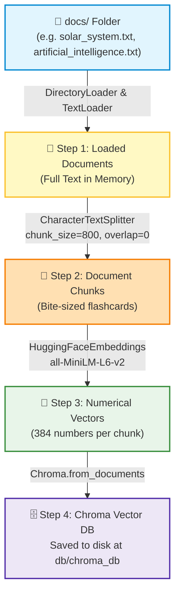

# The Ultimate Guide to the Ingestion Pipeline 🚀

> **Explained so simply that even a 5-year-old can understand it!**
> 
> This guide walks you through every single step, package, design decision, and concept behind [ingestion_pipeline.py](file:///home/supain/SupainNandy/RAG--Retrieval-Augmented-Generation/ingestion_pipeline.py).

---

## Table of Contents
1. [What is the Ingestion Pipeline? (Explain Like I'm 5)](#1-what-is-the-ingestion-pipeline-explain-like-im-5)
2. [Visual Pipeline Workflow](#2-visual-pipeline-workflow)
3. [Step-by-Step Code Walkthrough](#3-step-by-step-code-walkthrough)
   - [Setup and Imports](#setup-and-imports)
   - [Step 1: Document Loading (`load_documents`)](#step-1-document-loading-load_documents)
   - [Step 2: Document Chunking (`split_docs`)](#step-2-document-chunking-split_docs)
   - [Step 3: Embedding & Vector Storage (`create_vector_store`)](#step-3-embedding--vector-storage-create_vector_store)
   - [Step 4: The Conductor (`main` function)](#step-4-the-conductor-main-function)
4. [Package Encyclopedia: Every Library Explained](#4-package-encyclopedia-every-library-explained)
5. [Why Did We Use Hugging Face?](#5-why-did-we-use-hugging-face)
6. [Local Vector DB vs Cloud Vector DB](#6-local-vector-db-vs-cloud-vector-db)
   - [Why Did We NOT Use a Cloud Vector Database?](#why-did-we-not-use-a-cloud-vector-database)
   - [Examples of Cloud Vector Databases](#examples-of-cloud-vector-databases)
   - [How Cloud Vector DBs Work (Procedure & Code Comparison)](#how-cloud-vector-dbs-work-procedure--code-comparison)
   - [When Should You Switch to the Cloud?](#when-should-you-switch-to-the-cloud)
7. [Installation & Setup Guide](#7-installation--setup-guide)
8. [Quick Verification Checklist](#8-quick-verification-checklist)

---

## 1. What is the Ingestion Pipeline? (Explain Like I'm 5)

Imagine you have a giant box of loose toy instructions, storybooks, and school notes scattered all across your bedroom floor.

```
       Messy Storybooks & Notes 
                 ⬇️
       [ Ingestion Pipeline ] 
                 ⬇️
     Neat, Magic Toy Organizer (Vector DB)
```

If your friend asks: *"How do I build the LEGO rocket?"*, you cannot read through 50 giant books in 2 seconds while holding the phone.

The **Ingestion Pipeline** is like a super-smart librarian who visits your room **before** anyone asks a question:
1. **Picks up all the books** from your desk (**Loading**).
2. **Cuts them into neat, small flashcards** so they are easy to read (**Chunking**).
3. **Puts a magical number barcode on every flashcard** representing its exact meaning (**Embedding**).
4. **Files them into a neat, magical filing cabinet** on your computer (**Vector Database**).

Once the ingestion pipeline is finished, whenever anyone asks a question, your computer finds the exact flashcard in less than **0.01 seconds**!

---

## 2. Visual Pipeline Workflow

Here is the exact journey your documents take inside [ingestion_pipeline.py](file:///home/supain/SupainNandy/RAG--Retrieval-Augmented-Generation/ingestion_pipeline.py):



---

## 3. Step-by-Step Code Walkthrough

Let's dissect [ingestion_pipeline.py](file:///home/supain/SupainNandy/RAG--Retrieval-Augmented-Generation/ingestion_pipeline.py) line-by-line in plain English.

### Setup and Imports

```python
import os
import warnings

# Suppress deprecation warnings from langchain
warnings.filterwarnings("ignore", category=DeprecationWarning)

from dotenv import load_dotenv
from langchain_community.document_loaders import DirectoryLoader, TextLoader
from langchain_text_splitters import CharacterTextSplitter
from langchain_huggingface import HuggingFaceEmbeddings
from langchain_chroma import Chroma

load_dotenv()
```

- **`import os`**: Python's built-in tool for talking to your operating system (checking if folders exist, joining file paths).
- **`warnings.filterwarnings(...)`**: Python packages evolve quickly. Sometimes LangChain prints yellow warning messages saying *"this function might change in 6 months"*. This line keeps your terminal clean and quiet.
- **`load_dotenv()`**: Looks for a secret [.env](file:///home/supain/SupainNandy/RAG--Retrieval-Augmented-Generation/.env) file in your folder and loads your secret keys into your system's memory.

---

### Step 1: Document Loading (`load_documents`)

```python
def load_documents(docs_path="docs"):
    """Load all text files from the docs directory"""
    print(f"Loading documents from {docs_path}...")

    # Check if the docs directory is present
    if not os.path.exists(docs_path):
        raise FileNotFoundError(f"The directory {docs_path} does not exist.")

    # Load all .txt files from the docs directory
    loader = DirectoryLoader(
        path=docs_path,
        glob="*.txt",
        loader_cls=TextLoader,
        loader_kwargs={"encoding": "utf-8"},
    )

    documents = loader.load()
    ...
    return documents
```

#### What happens here?
- **Analogy:** You tell your assistant: *"Go into the folder named `docs` and bring me every text file you find!"*
- **`glob="*.txt"`**: A filter rule that says: *"Only pick files that end with `.txt`. Ignore pictures, zip files, or temporary files."*
- **`loader_cls=TextLoader`**: Tells LangChain how to open each file. `TextLoader` opens plain text files.
- **`encoding="utf-8"`**: Ensures international characters, emojis, and symbols are read correctly without turning into weird symbols (``).
- **Safety Check:** If the folder is missing or empty, it stops immediately with a friendly error instead of crashing mysteriously later.

---

### Step 2: Document Chunking (`split_docs`)

```python
def split_docs(documents, chunk_size=800, chunk_overlap=0):
    """Split documents into small chunks with overlap"""
    print("Splitting documents into chunks...")

    text_splitter = CharacterTextSplitter(
        chunk_size=chunk_size,
        chunk_overlap=chunk_overlap,
    )

    chunks = text_splitter.split_documents(documents)
    ...
    return chunks
```

#### What happens here?
- **Analogy:** If you try to eat a giant foot-long sandwich in one single bite, you will choke! You must slice the sandwich into small, neat bite-sized pieces.
- **`chunk_size=800`**: Each slice will be approximately 800 characters long.
- **`chunk_overlap=0`**: How many characters overlap between chunk 1 and chunk 2. Here it is `0`, meaning each chunk starts exactly where the previous one ended.

> [!TIP]
> **Why do we need chunking?**
> 1. **LLM Limits (Context Window):** AI models have limited memory. Passing 100 pages is expensive and slow. Passing 2 specific paragraphs is fast and cheap!
> 2. **Search Accuracy:** If you search for *"What color is Mars?"*, finding a small paragraph dedicated to Mars is 100x more accurate than returning a 50-page astronomy book.

---

### Step 3: Embedding & Vector Storage (`create_vector_store`)

```python
def create_vector_store(chunks, persist_dir="db/chroma_db"):
    """Create and persist ChromaDB vector store using local free embeddings"""
    print("Creating vector store...")

    # Free, local embedding model (no API key or credits needed)
    embeddings = HuggingFaceEmbeddings(
        model_name="sentence-transformers/all-MiniLM-L6-v2"
    )

    # Creating ChromaDB vector store
    vectorstore = Chroma.from_documents(
        documents=chunks,
        embedding=embeddings,
        persist_directory=persist_dir,
    )

    print(f"Vector store successfully created at {persist_dir}")
    ...
    return vectorstore
```

#### What happens here?
1. **The Embedding Model (`HuggingFaceEmbeddings`):**
   - It reads each text chunk (e.g., *"Mars is the fourth planet from the Sun"*).
   - It turns the sentence into a list of **384 numbers** (a vector) that captures the exact meaning of Mars, planets, and the Solar System.
2. **The Vector Database (`Chroma`):**
   - Takes all those chunks and their 384-dimensional number lists.
   - Saves them inside a local folder called `db/chroma_db` on your hard drive.
   - **`persist_directory`**: Means the database is permanently saved on your disk. When your Python script finishes running, your data is NOT deleted!

---

### Step 4: The Conductor (`main` function)

```python
def main():
    print("Main function started\n")

    # 1. Load documents
    docs = load_documents(docs_path="docs")

    # 2. Create chunks
    chunks = split_docs(docs)

    # 3. Create embeddings and store in Chroma Vector DB
    create_vector_store(chunks)

    print("Ingestion pipeline completed successfully!")


if __name__ == "__main__":
    main()
```

- **`if __name__ == "__main__":`**: This tells Python: *"Only run `main()` if someone directly executes `python ingestion_pipeline.py`. If another file imports this file, don't run it automatically."*
- Calls the steps in exact order: **Load ➡️ Chunk ➡️ Embed & Store**.

---

## 4. Package Encyclopedia: Every Library Explained

Here is every single package used across the project and [requirements.txt](file:///home/supain/SupainNandy/RAG--Retrieval-Augmented-Generation/requirements.txt):

| Package Name | What is it? (ELI5) | Why is it used? (Reason & Need) | What happens without it? |
| :--- | :--- | :--- | :--- |
| **`python-dotenv`** | The Secret Pocket | Reads sensitive passwords and API keys from [.env](file:///home/supain/SupainNandy/RAG--Retrieval-Augmented-Generation/.env) safely. | You would have to hardcode passwords inside Python code, which is a big security risk! |
| **`langchain`** | The Train Tracks | The master framework that links loaders, splitters, models, and databases together. | You would have to write hundreds of lines of complex custom glue code. |
| **`langchain-community`** | The Giant Tool Bag | Contains community-built tools like `DirectoryLoader` and `TextLoader` to read files. | Python wouldn't easily know how to open batches of `.txt`, `.pdf`, or `.docx` files. |
| **`langchain-text-splitters`** | The Document Scissors | Smartly slices long text into clean paragraphs without chopping words in half. | Big documents would overflow the AI's context window or crash the model. |
| **`langchain-huggingface`** | The Local AI Bridge | Connects LangChain to open-source models hosted on the Hugging Face hub. | You wouldn't be able to use free Hugging Face models inside your LangChain pipeline. |
| **`sentence-transformers`** | The Math Engine | The underlying deep learning engine that converts sentences into numerical vectors. | `HuggingFaceEmbeddings` cannot compute vectors without this library installed. |
| **`langchain-chroma`** | The Smart Toy Cabinet | The local Vector Database integration that stores and searches vectors. | You would have no place to save and search your document vectors. |
| **`langchain-openai`** | The OpenAI Phone Line | Connects to OpenAI models (GPT-4o, text-embedding-3). Prepared for generation. | You cannot call OpenAI models if you choose to use ChatGPT for answering questions. |
| **`langchain-groq`** | The Speed Demon LLM | Connects to Groq's ultra-fast LPU cloud to run open models (Llama 3, Mixtral). | You cannot call Groq's high-speed free API for generating answers. |

---

## 5. Why Did We Use Hugging Face?

Inside [ingestion_pipeline.py](file:///home/supain/SupainNandy/RAG--Retrieval-Augmented-Generation/ingestion_pipeline.py#L82-L86), we used:
```python
embeddings = HuggingFaceEmbeddings(
    model_name="sentence-transformers/all-MiniLM-L6-v2"
)
```

Instead of using a paid cloud API like OpenAI (`text-embedding-3-small`), why did we pick Hugging Face?

### 🌟 6 Big Benefits of Hugging Face (`all-MiniLM-L6-v2`)

1. **100% Free Forever (Zero Cost):**
   - No credit cards, no billing alerts, no trial credits expiring.
2. **No API Key Required (Zero Setup Friction):**
   - You don't need to sign up, generate a secret key, or configure tokens. It works right out of the box!
3. **Runs 100% Locally on Your Machine (Offline Capable):**
   - The first time you run it, the model files (~80 MB) download to your computer. After that, it runs completely offline without sending a single byte to the internet!
4. **Complete Privacy & Security:**
   - Your private notes, company documents, or personal data never leave your computer.
5. **No Rate Limits or 429 Errors:**
   - Cloud APIs frequently block you with errors like `"Rate limit reached"` or `"Too many requests"`. Local models process as much text as your CPU can handle without complaints.
6. **Extremely Fast and Lightweight:**
   - `all-MiniLM-L6-v2` produces a compact **384-dimensional vector**. It runs super fast even on an ordinary laptop without an expensive GPU!

### Comparison: Hugging Face Local vs OpenAI Embeddings

| Feature | Hugging Face (`all-MiniLM-L6-v2`) | OpenAI (`text-embedding-3-small`) |
| :--- | :--- | :--- |
| **Cost** | 🟢 **$0.00 (100% Free)** | 🔴 Paid (Per 1 Million tokens) |
| **API Key Needed?** | 🟢 **No** | 🔴 Yes (`OPENAI_API_KEY`) |
| **Runs Where?** | 🟢 **Your Local Laptop / CPU** | 🟡 OpenAI Cloud Servers |
| **Privacy** | 🟢 **100% Private (Never leaves PC)** | 🟡 Sent to OpenAI over internet |
| **Internet Needed?**| 🟢 **Only once to download** | 🔴 Always required for every query |
| **Vector Dimensions**| 384 numbers | 1536 numbers |

---

## 6. Local Vector DB vs Cloud Vector DB

In our project, we chose **Chroma** (a Local Vector Database). But what about Cloud Vector Databases?

### Why Did We NOT Use a Cloud Vector Database?

```
┌─────────────────────────────────────────────────────────────┐
│                       LOCAL (Chroma)                        │
│   [Your Code] ──(Direct File Access)──> [Local Disk Folder] │
│   ⚡ 0.001s Latency | 💰 $0 Cost | 🔒 100% Private         │
└─────────────────────────────────────────────────────────────┘

┌─────────────────────────────────────────────────────────────┐
│                    CLOUD (e.g. Pinecone)                    │
│   [Your Code] ──(HTTPS over Internet)──> [Cloud Server]     │
│   🌐 0.150s Latency | 💳 Monthly Subscriptions | 🔑 API Key │
└─────────────────────────────────────────────────────────────┘
```

Here are the 5 reasons why a Cloud Vector DB was **not** used for this project:

1. **Unnecessary Complexity & Setup:**
   - A cloud database requires creating an online account, verifying an email, setting up an organization, configuring index names, dimensions, and cloud regions (e.g. `us-east-1`).
   - With Chroma, it is just **1 line of code**, and it creates a folder on your disk.
2. **Cost & Billing Surprises:**
   - Cloud vector databases often charge monthly fees or have free tiers that expire, shut down after inactivity, or charge when you exceed vector limits.
   - Chroma on your computer is **free forever**.
3. **Internet Dependency & Network Latency:**
   - Every time you search in a cloud database, your request travels across the ocean to a cloud data center and back. That adds 50ms to 200ms of delay.
   - Local Chroma searches files right on your SSD in **1 to 2 milliseconds**!
4. **Data Privacy:**
   - Many companies and developers do not want their internal documents stored on someone else's cloud servers.
5. **Overkill for Small to Medium Projects:**
   - For a few dozen, hundreds, or even tens of thousands of document chunks, a local database like Chroma is more than fast enough.

---

### Examples of Cloud Vector Databases

If you ever build an enterprise application with millions of users, here are the most popular Cloud Vector Databases:

| Cloud Vector DB | Description | Best Suited For |
| :--- | :--- | :--- |
| **Pinecone** | The most popular 100% managed serverless vector database. No infrastructure to manage. | Fast startup for production web apps, zero DevOps. |
| **Qdrant Cloud** | Ultra-fast vector search engine written in Rust with rich payload filtering. | High-performance filtering and hybrid search. |
| **Weaviate Cloud** | Open-source vector engine with built-in modules for vectorization and generative search. | Complex data graphs and multi-modal search (text + images). |
| **Milvus / Zilliz Cloud** | Massive enterprise-scale vector database built to handle billions of vectors. | Huge enterprise datasets (billions of embeddings). |
| **Supabase (pgvector)**| PostgreSQL cloud database enhanced with vector similarity search extensions. | Apps that already use PostgreSQL for regular tables. |
| **AWS OpenSearch / Azure AI Search** | Cloud-managed search clusters offered by big cloud providers. | Existing enterprise cloud ecosystems. |

---

### How Cloud Vector DBs Work (Procedure & Code Comparison)

To see the difference in practice, look at how the code changes between **Local Chroma** and **Cloud Pinecone**:

#### Option A: Local Chroma (Our Current Code)
```python
from langchain_chroma import Chroma
from langchain_huggingface import HuggingFaceEmbeddings

# 1. Initialize embeddings
embeddings = HuggingFaceEmbeddings(model_name="sentence-transformers/all-MiniLM-L6-v2")

# 2. Save directly to local hard drive (Zero credentials!)
vectorstore = Chroma.from_documents(
    documents=chunks,
    embedding=embeddings,
    persist_directory="db/chroma_db"
)
```

#### Option B: Cloud Vector Database (e.g., Pinecone)
```python
import os
from pinecone import Pinecone, ServerlessSpec
from langchain_pinecone import PineconeVectorStore
from langchain_huggingface import HuggingFaceEmbeddings

# 1. Must pass Cloud API Key
pc = Pinecone(api_key=os.getenv("PINECONE_API_KEY"))

# 2. Must manually create the cloud index if it doesn't exist
index_name = "my-rag-index"
if index_name not in pc.list_indexes().names():
    pc.create_index(
        name=index_name,
        dimension=384, # Must exactly match embedding dimension!
        metric="cosine",
        spec=ServerlessSpec(cloud="aws", region="us-east-1")
    )

# 3. Connect and upload vectors over the internet
vectorstore = PineconeVectorStore.from_documents(
    documents=chunks,
    embedding=embeddings,
    index_name=index_name
)
```

> [!NOTE]
> Notice how the cloud approach requires API keys, network connections, cloud regions, index creation, and dimension matching!

---

### When Should You Switch to the Cloud?

You should upgrade from a Local Vector DB (Chroma) to a Cloud Vector DB when:
1. **You have multiple servers/users:** If 10,000 users are chatting with your app at the same time across multiple web servers, they all need to access the same central database.
2. **Massive Scale:** You have **millions of documents** (gigabytes of vectors) that cannot fit into a single computer's RAM.
3. **High Availability (99.99% Uptime):** You need automatic backups, failover protection, and enterprise compliance (SOC2, HIPAA).

---

## 7. Installation & Setup Guide

Follow these steps to run the ingestion pipeline from scratch:

### 1. Activate your Virtual Environment
Open your terminal inside this repository and activate the virtual environment:

```bash
# On Linux / macOS:
source venv/bin/activate

# On Windows (PowerShell):
venv\Scripts\Activate.ps1
```

### 2. Install All Required Packages
Run this single command to install all necessary packages from [requirements.txt](file:///home/supain/SupainNandy/RAG--Retrieval-Augmented-Generation/requirements.txt):

```bash
pip install -r requirements.txt
```

### 3. Add Your Text Documents
Make sure you have text files inside the `docs/` folder:
- [solar_system.txt](file:///home/supain/SupainNandy/RAG--Retrieval-Augmented-Generation/docs/solar_system.txt)
- [artificial_intelligence.txt](file:///home/supain/SupainNandy/RAG--Retrieval-Augmented-Generation/docs/artificial_intelligence.txt)

*(You can add any other `.txt` files you want!)*

### 4. Run the Ingestion Pipeline!
Execute the script:

```bash
python ingestion_pipeline.py
```

You will see:
```text
Main function started

Loading documents from docs...
Successfully loaded 2 document(s).

Splitting documents into chunks...
---- Chunk 1 ----
...
Creating vector store...
Vector store successfully created at db/chroma_db
Total chunks indexed in Vector DB: 12

Ingestion pipeline completed successfully!
```

---

## 8. Quick Verification Checklist

After running the pipeline, verify everything worked:
- [x] A folder named `db/chroma_db/` was created.
- [x] Inside `db/chroma_db/`, you will see a `chroma.sqlite3` file and folder containing indexed binary files.
- [x] No API errors or payment prompts were encountered!
- [x] Your documents are now indexed and ready for the **Retrieval & Question-Answering Pipeline**! 🎯
