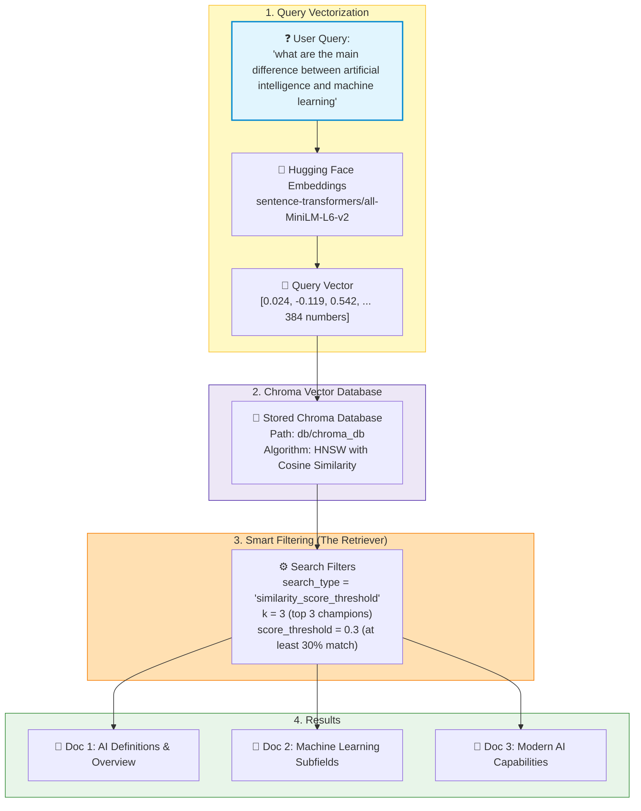

# The Ultimate Guide to the Retrieval Pipeline 🔍

> **Explained so simply that even a 5-year-old child can understand it!**
> 
> This guide explains every single line of code, package, parameter, and math concept inside [2_retrival_pipeline.py](file:///home/supain/SupainNandy/RAG--Retrieval-Augmented-Generation/2_retrival_pipeline.py).

---

## 📖 Table of Contents
1. [What is Retrieval? (Explain Like I'm 5)](#1-what-is-retrieval-explain-like-im-5)
2. [The Big Picture: How RAG Works](#2-the-big-picture-how-rag-works)
3. [Visual Pipeline Workflow](#3-visual-pipeline-workflow)
4. [Line-by-Line Code Walkthrough](#4-line-by-line-code-walkthrough)
   - [Imports & Clean Console](#step-1-imports--clean-console)
   - [Opening the Saved Filing Cabinet](#step-2-opening-the-saved-filing-cabinet)
   - [The Translator (Embeddings)](#step-3-the-translator-embeddings)
   - [Loading Chroma Vector Store with Cosine Space](#step-4-loading-chroma-vector-store)
   - [Creating the Smart Retriever](#step-5-creating-the-smart-retriever)
   - [Invoking & Printing the Results](#step-6-invoking--printing-the-results)
5. [Deep Dive: Key Concepts with Simple Examples](#5-deep-dive-key-concepts-with-simple-examples)
   - [What is an Embedding? (The Fruit Basket Example)](#what-is-an-embedding-the-fruit-basket-example)
   - [What is Cosine Similarity? (The Compass Example)](#what-is-cosine-similarity-the-compass-example)
   - [What is `k=3` and `score_threshold=0.3`? (The Toy Store Rule)](#what-is-k3-and-score_threshold03)
   - [Difference: `similarity` vs `similarity_score_threshold` vs `mmr`](#difference-between-search-types)
6. [How to Run & Expected Output](#6-how-to-run--expected-output)
7. [Common Bugs & Fixes (Learned from Experience)](#7-common-bugs--fixes)
8. [Next Step: The Generation Pipeline (Step 3)](#8-next-step-the-generation-pipeline-step-3)

---

## 1. What is Retrieval? (Explain Like I'm 5)

Imagine you have a giant toy chest filled with **1,000 flashcards**. 

In **Step 1 (Ingestion)**, we neatly filed all those flashcards into special folders inside a magical cabinet.

Now in **Step 2 (Retrieval)**, your friend walks in and asks:
> *"Hey! What is the difference between Artificial Intelligence and Machine Learning?"*

```
   Friend's Question                     Magical Robot Detective                 Exact Flashcards Found
 ┌──────────────────────┐               ┌───────────────────────┐               ┌──────────────────────┐
 │ "What is the         │  ──────────▶  │ Compares meaning with │  ──────────▶  │ Top 3 matching       │
 │ difference between   │               │ all flashcards in     │               │ cards from folder    │
 │ AI and ML?"          │               │ 0.002 seconds!        │               │                      │
 └──────────────────────┘               └───────────────────────┘               └──────────────────────┘
```

You do **not** want to read all 1,000 flashcards from top to bottom while your friend waits on the phone. That is too slow!

Instead, our **Retrieval Pipeline** acts like a **super-fast robot detective**:
1. It listens to your friend's question.
2. It turns the question into secret mathematical coordinates (vectors).
3. It zooms directly to the exact shelf where cards with the same meaning live.
4. It picks only the **best 3 flashcards** and hands them to you!

---

## 2. The Big Picture: How RAG Works

RAG stands for **Retrieval-Augmented Generation**:

| Stage | Name | File | What it Does | Real Life Analogy |
|---|---|---|---|---|
| **R** | **Retrieval** | [2_retrival_pipeline.py](file:///home/supain/SupainNandy/RAG--Retrieval-Augmented-Generation/2_retrival_pipeline.py) | Finds relevant facts from stored data | Detective finding the clue in a library |
| **A** | **Augmented** | [3_rag_pipeline.py](file:///home/supain/SupainNandy/RAG--Retrieval-Augmented-Generation/3_rag_pipeline.py) | Attaches those facts to the prompt | Putting the clue on the judge's desk |
| **G** | **Generation** | [3_rag_pipeline.py](file:///home/supain/SupainNandy/RAG--Retrieval-Augmented-Generation/3_rag_pipeline.py) | LLM writes a clear human answer | The judge reading the clue and answering |

This file ([2_retrival_pipeline.py](file:///home/supain/SupainNandy/RAG--Retrieval-Augmented-Generation/2_retrival_pipeline.py)) is the **R** in RAG!

---

## 3. Visual Pipeline Workflow

Here is the exact journey of a query inside [2_retrival_pipeline.py](file:///home/supain/SupainNandy/RAG--Retrieval-Augmented-Generation/2_retrival_pipeline.py):



---

## 4. Line-by-Line Code Walkthrough

Let's read every single piece of code in [2_retrival_pipeline.py](file:///home/supain/SupainNandy/RAG--Retrieval-Augmented-Generation/2_retrival_pipeline.py) in simple words.

### Step 1: Imports & Clean Console

```python
from langchain_chroma import Chroma
from langchain_huggingface import HuggingFaceEmbeddings
import os
import warnings

# Suppress deprecation warnings from langchain
warnings.filterwarnings("ignore", category=DeprecationWarning)

from dotenv import load_dotenv

load_dotenv()
```

- **`from langchain_chroma import Chroma`**: Chroma is our **vector database** (the hard drive filing cabinet where chunks live).
- **`from langchain_huggingface import HuggingFaceEmbeddings`**: The **translator** that converts words into 384 numbers.
- **`warnings.filterwarnings("ignore", category=DeprecationWarning)`**: Keeps the console clean by hiding yellow warning messages about future package changes.
- **`load_dotenv()`**: Loads your `.env` file so environment keys are available.

---

### Step 2: Pointing to the Saved Cabinet

```python
persistent_directry = "db/chroma_db"
```

- In `1_ingestion_pipeline.py`, we saved all our chunks into a folder on our computer called `db/chroma_db`.
- Here, we tell Python: *"Look in this exact folder to find our saved flashcards."*

---

### Step 3: The Translator (Embeddings)

```python
# Loading the embeddings model
embeddings = HuggingFaceEmbeddings(
    model_name="sentence-transformers/all-MiniLM-L6-v2"
)
```

> [!IMPORTANT]
> **Golden Rule of RAG:**
> You **MUST** use the exact same embedding model during Retrieval that you used during Ingestion!
> 
> If you used French during Ingestion, you cannot use Japanese during Retrieval. Both must speak the exact same language (`sentence-transformers/all-MiniLM-L6-v2`).

- **Model name**: `all-MiniLM-L6-v2` is free, fast, runs directly on your computer's CPU, and needs zero paid API keys!
- It converts any sentence into a list of **384 mathematical numbers** that represent its meaning.

---

### Step 4: Loading Chroma Vector Store

```python
# Load the vector store from disk
db = Chroma (
    persist_directory=persistent_directry,
    embedding_function=embeddings,
    collection_metadata={"hnsw:space": "cosine"} # which algorithm we use
)
```

- **`persist_directory=persistent_directry`**: Tells Chroma where to load the saved database from.
- **`embedding_function=embeddings`**: Provides the translator model so Chroma can turn new questions into numbers.
- **`collection_metadata={"hnsw:space": "cosine"}`**:
  - **HNSW** (*Hierarchical Navigable Small World*): A super-fast shortcut highway system through multidimensional space.
  - **Cosine**: Measures the **angle/direction** between two thoughts rather than the length of the text.

---

### Step 5: Creating the Smart Retriever

```python
# Search relevant document
query = "what are the main differenece between artificial intelligence and machine learning"

retriever = db.as_retriever(
    search_type="similarity_score_threshold",
    search_kwargs={
        "k": 3,               # Retrieve only top 3 chunks
        "score_threshold": 0.3 # Only return chunks with cosine similarity above 0.3
    }
)
```

This is where the magic happens! Let's understand each setting:

1. **`db.as_retriever(...)`**:
   - Converts the raw database into a standard LangChain **Retriever** object.
   - A retriever is like a vending machine: you insert a query string, press the button, and out come the documents!

2. **`search_type="similarity_score_threshold"`**:
   - Instead of blindly returning cards, only return cards that pass a minimum similarity test.

3. **`"k": 3`**:
   - The maximum number of documents to return (Gold, Silver, Bronze champions).

4. **`"score_threshold": 0.3`**:
   - Quality control! If a card matches less than 30% (0.3), discard it. We do not want irrelevant documents!

---

### Step 6: Invoking & Printing the Results

```python
relevent_docs = retriever.invoke(query)

print("=" * 60)
print(f"User Query: {query}")
print("=" * 60)
print(f"Total Relevant Documents Retrieved: {len(relevent_docs)}\n")

for i, doc in enumerate(relevent_docs, 1):
    source = doc.metadata.get("source", "Unknown")
    print(f"--- Document {i} [Source: {source}] ---")
    print(doc.page_content.strip())
    print("-" * 60 + "\n")
```

- **`retriever.invoke(query)`**:
  1. Takes the user query string.
  2. Runs it through `embeddings.embed_query(query)`.
  3. Searches Chroma DB using Cosine Similarity.
  4. Applies the threshold filter (`>= 0.3`) and limit (`k=3`).
  5. Returns a Python list of `Document` objects.
- **`for i, doc in enumerate(relevent_docs, 1):`**:
  - Prints each retrieved document cleanly with its source file and exact text.

---

## 5. Deep Dive: Key Concepts with Simple Examples

### What is an Embedding? (The Fruit Basket Example)

Imagine you describe fruits using two numbers: **Sweetness (1-10)** and **Crunchiness (1-10)**.

```
                  Crunchy (10)
                       │
                       │     🍏 Green Apple (8, 9)
                       │
                       │
  Sour (0) ────────────┼──────────── Sweet (10)
                       │
                       │     🍌 Ripe Banana (9, 2)
                       │
                  Soft (0)
```

- **Green Apple**: Sweetness = 8, Crunchiness = 9 → Vector: `[8, 9]`
- **Ripe Banana**: Sweetness = 9, Crunchiness = 2 → Vector: `[9, 2]`
- **Spaceship Rocket**: Sweetness = 0, Crunchiness = 0 → Vector: `[0, 0]`

When someone asks: *"Give me something sweet and crunchy to eat!"* (`[8, 8]`), the computer calculates the distance and gives you the **Green Apple**, not the Spaceship!

In our code, instead of 2 numbers, `sentence-transformers/all-MiniLM-L6-v2` uses **384 numbers** to capture every detail of language!

---

### What is Cosine Similarity? (The Compass Example)

Imagine two arrows on a compass table:

```
        Same Direction                  Perpendicular                  Opposite Direction
      (Cosine Score = 1.0)           (Cosine Score = 0.0)             (Cosine Score = -1.0)
     "Puppy" vs "Small Dog"          "Puppy" vs "Pineapple"           "Hot Fire" vs "Iceberg"
            ↗️  ↗️                           ↗️                                ↗️
           (Angle: 0°)                      └──▶                            ↙️
                                       (Angle: 90°)                    (Angle: 180°)
```

- **Cosine = 1.0**: Perfect match (talking about the exact same idea).
- **Cosine = 0.3 to 0.7**: Good match (related topic).
- **Cosine = 0.0**: Completely unrelated (e.g. "Artificial Intelligence" vs "Potato Chips").
- **Cosine = -1.0**: Complete opposites.

---

### What is `k=3` and `score_threshold=0.3`?

Think of a ride at an amusement park:
- **`score_threshold=0.3`** is the **Height Requirement**:
  - If a card is too short (score < 0.3), the guard says: *"You cannot enter!"*
- **`k=3`** is the **Car Capacity**:
  - The roller coaster car only has 3 seats. Even if 10 cards qualify, only the top 3 tallest riders get on the ride!

---

### Difference Between Search Types

LangChain Chroma supports different retriever search types:

| Search Type | How it Works | When to Use |
|---|---|---|
| `similarity` | Returns top `k` cards, even if they have low scores | When you always want answers, even if weak |
| `similarity_score_threshold` | Returns top `k` cards **ONLY** if their score exceeds threshold | **(Recommended)** Prevents irrelevant garbage |
| `mmr` *(Maximal Marginal Relevance)* | Balances similarity with diversity to avoid duplicate ideas | When you have many repetitive documents |

---

## 6. How to Run & Expected Output

### Running the Script

Activate your virtual environment and run the script from the terminal:

```bash
./venv/bin/python 2_retrival_pipeline.py
```

### Expected Output

```text
Loading weights: 100%|████████████████████| 103/103 [00:00<00:00, 10072.82it/s]
============================================================
User Query: what are the main differenece between artificial intelligence and machine learning
============================================================
Total Relevant Documents Retrieved: 3

--- Document 1 [Source: docs/artificial_intelligence.txt] ---
ARTIFICIAL INTELLIGENCE: COMPREHENSIVE OVERVIEW AND RESEARCH FOUNDATIONS

1. Introduction and Definitions
Artificial Intelligence (AI) is the intelligence demonstrated by machines, as opposed to the natural intelligence displayed by humans and animals. In computer science, AI research is defined as the study of intelligent agents: any system that perceives its environment and takes actions that maximize its chance of achieving its goals. Popularly, the term artificial intelligence is used to describe machines that mimic cognitive functions that humans associate with the human mind, such as learning and problem solving.
------------------------------------------------------------

--- Document 2 [Source: docs/artificial_intelligence.txt] ---
Machine Learning (ML):
Machine learning involves algorithms that discover patterns and learn from data without being explicitly programmed with static rules. It is broadly categorized into:
- Supervised Learning: The algorithm is provided with labeled training data, consisting of input features and desired output labels. Common tasks include classification and regression.
- Unsupervised Learning: The algorithm discovers hidden patterns, groupings, or clusters in unlabeled data. Techniques include k-means clustering, principal component analysis (PCA), and autoencoders.
- Reinforcement Learning: An agent learns by interacting with an environment, receiving numerical rewards for favorable actions and penalties for unfavorable ones...
------------------------------------------------------------

--- Document 3 [Source: docs/artificial_intelligence.txt] ---
As machines become increasingly capable, tasks considered to require intelligence are often removed from the definition of AI, a phenomenon known as the AI effect...
------------------------------------------------------------
```

Notice how it accurately retrieved:
1. The **AI definition**.
2. The **Machine Learning definition and categories**.
3. The **AI vs traditional tasks context**.

---

## 7. Common Bugs & Fixes

During development, we solved these common real-world bugs:

### Bug 1: `NameError: name 'retriever' is not defined`
- **Why it happened**: The variable was defined as `retriever_query = db.as_retriever(...)`, but invoked as `relevent_docs = retriever.invoke(query)`.
- **The Fix**: Renamed `retriever_query` to `retriever`.

### Bug 2: Duplicate Chunks in Search Results
- **Why it happened**: `1_ingestion_pipeline.py` was executed multiple times, appending copies of the same chunks to `db/chroma_db`.
- **The Fix**: Deleted old `db/chroma_db` folder and re-ran ingestion once to store clean, unique chunks.

### Bug 3: Accidental IDE Auto-Imports
- **Why it happened**: When typing `search` and `query`, the IDE automatically added `from re import search` and `from httpx2 import query` at the top of the file.
- **The Fix**: Removed unused imports so the script stays clean and lightweight.

---

## 8. Next Step: The Generation Pipeline (Step 3)

Now that our **Retrieval Pipeline** can accurately fetch the best facts, we are ready for **Step 3 (Generation)**:

```
 User Question ──┐
                 ├──▶ Combine into Prompt ──▶ Large Language Model (OpenAI / Groq) ──▶ Final Answer!
 Retrieved Facts ─┘
```

In the next script (`3_rag_pipeline.py`), we will feed these 3 retrieved documents into an LLM (like GPT-4o or Llama-3 via Groq) to craft a fluent, factual answer! 🚀
