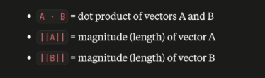
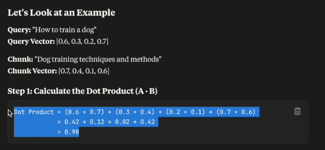
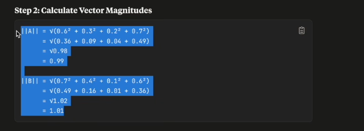
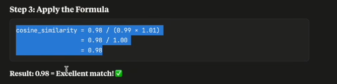
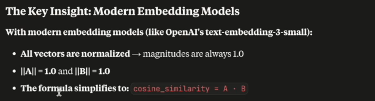

# Cosine Similarity: The Ultimate Beginner-Friendly Guide

> **Explained so simply that even a 5-year-old child can understand it!**
>
> In this guide, you will learn what **Cosine Similarity** is, why AI and RAG use it to find the right information, how the math works step-by-step with real numbers and pictures, and why it is super fast!

---

## Table of Contents
1. [The 5-Year-Old Explanation: The "Pointing Fingers" Game](#1-the-5-year-old-explanation-the-pointing-fingers-game)
2. [Why Do We Need Cosine Similarity in RAG?](#2-why-do-we-need-cosine-similarity-in-rag)
3. [Why Direction Matters (And Length Doesn't!)](#3-why-direction-matters-and-length-doesnt)
4. [The Score Board: What the Numbers Mean](#4-the-score-board-what-the-numbers-mean)
5. [The Formula (Made Super Simple)](#5-the-formula-made-super-simple)
6. [Step-by-Step Example (With Real Numbers!)](#6-step-by-step-example-with-real-numbers)
   - [Step 1: Calculate the Dot Product](#step-1-calculate-the-dot-product-a--b)
   - [Step 2: Calculate Vector Magnitudes](#step-2-calculate-vector-magnitudes-a-and-b)
   - [Step 3: Apply the Formula](#step-3-apply-the-formula)
7. [The Secret Superpower of Modern AI (Why It's So Fast!)](#7-the-secret-superpower-of-modern-ai-why-its-so-fast)
8. [Summary: Remember This!](#8-summary-remember-this)

---

## 1. The 5-Year-Old Explanation: The "Pointing Fingers" Game

Imagine you and your best friend are standing together in a big playroom.

```text
You & Friend Pointing at Same Toy (Match!)        You & Friend Pointing Away (No Match!)

               [Teddy Bear]                                   [Teddy Bear]
                  ^    ^                                           ^
                 /      \                                          |
                /        \                                         |
             [You]    [Friend]                                  [You] -----> [Friend] (Looking at Window)

        Score = 1.0 (Same Direction!)                        Score = 0.0 (Unrelated!)
```

### The 3 Rules of the Game:

1. **Pointing to the exact same toy (Score = 1.0):**
   - You point your finger directly at the teddy bear.
   - Your friend points their finger at the exact same teddy bear.
   - Both your fingers are pointing in the **exact same direction**!
   - **Cosine Similarity = 1.0 (Perfect Match!)**

2. **Pointing to completely different things (Score = 0.0):**
   - You point straight ahead at the teddy bear.
   - Your friend points out the window to the side at a passing car.
   - You two are pointing at completely different things that have nothing in common.
   - **Cosine Similarity = 0.0 (No Match! Totally Unrelated!)**

3. **Pointing in opposite directions (Score = -1.0):**
   - You point forward towards the door.
   - Your friend points backward towards the wall behind you.
   - **Cosine Similarity = -1.0 (Complete Opposites!)**

> **The Big Idea:**  
> Cosine Similarity is just a friendly math tool that asks one simple question:  
> **"Are these two arrows pointing in the same direction?"**

---

## 2. Why Do We Need Cosine Similarity in RAG?

In a **RAG (Retrieval-Augmented Generation)** system, you have a big library of text chunks (like pages from a book) saved in a **Vector Database** (like ChromaDB).

When a user asks a question:
> *"How do I train my puppy?"*

Here is what happens behind the scenes:
1. The computer **cannot** understand raw English words directly.
2. An **Embedding Model** translates the user's question into a list of numbers called a **Vector** (think of it as an arrow pointing in space).
3. The database already has all book chunks saved as vectors (arrows).
4. The database uses **Cosine Similarity** to compare the user's question arrow with all the book chunk arrows.
5. Whichever chunk's arrow is pointing in almost the **exact same direction** is selected and handed to the AI model!

```text
User Query: "How to train my puppy?" ----> [Vector A: Arrow pointing up-right]
                                                         |
                                                         v  (Cosine Similarity Check)
[Chunk 1: "Dog training techniques"] ----> [Vector B: Arrow pointing up-right] ----> Score: 0.98 (Match!)
[Chunk 2: "Baking chocolate cake"]   ----> [Vector C: Arrow pointing down-right] --> Score: 0.02 (No Match!)
```

---

## 3. Why Direction Matters (And Length Doesn't!)

You might wonder: *"Why don't we just measure the distance between words, or count how long the text is?"*

Let's look at two sentences:
- **Sentence A (Short):** *"I love puppies."* (3 words)
- **Sentence B (Long):** *"I absolutely adore sweet, playful little baby puppy dogs with all my heart and soul."* (15 words)

Both sentences mean the **exact same thing**: they both express love for puppies!

- If we measured **length** (word count or arrow magnitude), the computer would think they are completely different because Sentence B is 5 times longer!
- But if we look at **direction**, both arrows are pointing straight at the concept of **"Puppy Love"**!

> **Key Rule:**  
> **Cosine similarity ignores how long the arrow is (length / magnitude). It ONLY cares about the direction (the angle between them)!**

---

## 4. The Score Board: What the Numbers Mean

The cosine similarity score always falls between **-1.0 and +1.0** (and in text embeddings, almost always between **0.0 and 1.0**):

| Cosine Score | Angle Between Arrows | Meaning in Plain English | Real-Life Example |
| :---: | :---: | :--- | :--- |
| **`1.0`** | **0°** (Pointing together) | **Identical Meaning** | *"Puppy"* vs *"Baby dog"* |
| **`0.80 - 0.99`** | **Tiny angle** | **Super Close Match!** | *"How to train a dog"* vs *"Dog training techniques"* |
| **`0.40 - 0.70`** | **Medium angle** | **Somewhat Related** | *"Dog food recipes"* vs *"Veterinarian checkup"* |
| **`0.0`** | **90°** (Right angle) | **Completely Unrelated** | *"How to train a dog"* vs *"Quantum physics in space"* |
| **`-1.0`** | **180°** (Opposite) | **Exact Opposites** | *"I love sunny days"* vs *"I hate sunny days"* |

---

## 5. The Formula (Made Super Simple)

Here is the official math formula for Cosine Similarity:

$$\text{cosine\_similarity} = \frac{A \cdot B}{\|A\| \times \|B\|}$$

Let's break down each piece using this picture:



- **A**: The first arrow (for example, the User's Query Vector).
- **B**: The second arrow (for example, a Document Chunk Vector).
- **A · B (Dot Product)**: Multiply each pair of numbers together and add up the totals. This checks how much the two arrows agree with each other.
- **||A|| (Magnitude / Length of A)**: A virtual ruler measuring how long arrow A is.
- **||B|| (Magnitude / Length of B)**: A virtual ruler measuring how long arrow B is.
- **Division ( / )**: We divide by the lengths to cancel out arrow size. This ensures long text and short text are treated fairly!

---

## 6. Step-by-Step Example (With Real Numbers!)

Let's do an actual calculation step-by-step just like a computer does!

Suppose:
- **User Query (A):** *"How to train a dog"*  
  Vector A = `[0.6, 0.3, 0.2, 0.7]`
- **Document Chunk (B):** *"Dog training techniques and methods"*  
  Vector B = `[0.7, 0.4, 0.1, 0.6]`

---

### Step 1: Calculate the Dot Product (A · B)

Take each partner number, multiply them together, and add them all up:



```text
Dot Product = (0.6 × 0.7) + (0.3 × 0.4) + (0.2 × 0.1) + (0.7 × 0.6)
            =    0.42     +    0.12     +    0.02     +    0.42
            = 0.98
```

---

### Step 2: Calculate Vector Magnitudes (||A|| and ||B||)

Square each number, add them together, and take the square root (just like finding the long side of a triangle):



- **Length of Vector A (||A||):**
  ```text
  ||A|| = √(0.6² + 0.3² + 0.2² + 0.7²)
        = √(0.36 + 0.09 + 0.04 + 0.49)
        = √0.98
        ≈ 0.99
  ```

- **Length of Vector B (||B||):**
  ```text
  ||B|| = √(0.7² + 0.4² + 0.1² + 0.6²)
        = √(0.49 + 0.16 + 0.01 + 0.36)
        = √1.02
        ≈ 1.01
  ```

---

### Step 3: Apply the Formula

Now divide the Dot Product by the product of both lengths:



```text
cosine_similarity = 0.98 / (0.99 × 1.01)
                  = 0.98 / 1.00
                  = 0.98
```

**Result: 0.98 = Excellent Match!**  
Because 0.98 is almost 1.0, the database knows this chunk has the exact answer to the user's question!

---

## 7. The Secret Superpower of Modern AI (Why It's So Fast!)

You might be thinking:
> *"Wait a minute! If my database has 100,000 documents, does the computer have to calculate square roots and divide every single time? Won't that be slow?"*

Here is the genius secret of modern embedding models (like OpenAI's `text-embedding-3-small` or HuggingFace):



### The Magic of "Normalized" Vectors:
1. Modern models automatically **normalize** every vector before saving it.
2. "Normalized" means the model adjusts every vector so its length is **always exactly 1.0**:
   $$\|A\| = 1.0 \quad \text{and} \quad \|B\| = 1.0$$
3. When both lengths are always 1.0, look what happens to our formula:
   $$\text{cosine\_similarity} = \frac{A \cdot B}{1.0 \times 1.0} = \mathbf{A \cdot B}$$

**The formula simplifies to just the Dot Product!**
- No square roots to calculate!
- No division needed!
- Just fast multiplication and addition!

This is why your Vector Database (like ChromaDB) can compare your question against thousands of chunks in just **a few milliseconds**!

---

## 8. Summary: Remember This!

| Question | Simple 5-Year-Old Answer |
| :--- | :--- |
| **What is a Vector?** | A list of numbers that acts like an arrow pointing to the meaning of words. |
| **What is Cosine Similarity?** | A score that checks if two arrows are pointing in the same direction. |
| **Why not Euclidean Distance?** | Because long sentences and short sentences can mean the exact same thing; direction matters, length does not! |
| **What does 1.0 mean?** | Identical meaning! Best match! |
| **What does 0.0 mean?** | Completely unrelated topic. |
| **Why is it so fast?** | Modern AI sets vector lengths to 1.0, turning the whole calculation into a super-fast Dot Product! |
