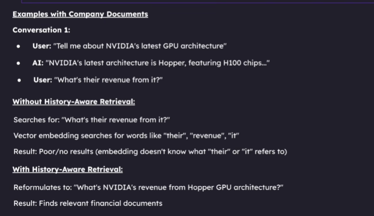
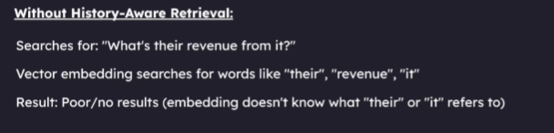

# History-Aware RAG: A Simple Step-by-Step Guide

This guide explains [`4_history_aware_generation.py`](./4_history_aware_generation.py)
in easy English. Imagine the program is a helpful librarian robot: it remembers
the recent conversation, finds useful pages in your documents, and then answers
your question.

## What does "history-aware" mean?

In a normal chat, each question can be treated as a brand-new question. But people
often ask short follow-up questions that only make sense with the earlier
conversation.

For example:

1. You ask: **"Tell me about the solar system."**
2. The assistant explains the Sun and planets.
3. You ask: **"How many planets does it have?"**

The word **"it"** means the solar system. The script looks at the conversation
and rewrites the follow-up as a clearer search question, such as **"How many
planets are in the solar system?"** It then searches your document collection
with that clearer question.



Without chat history, words like "it" or "their" can be unclear to the document
search. With history, the system can replace them with the topic from the
earlier messages.



## The whole journey

```text
Start the script
      |
Load settings, documents database, and language model
      |
Ask the user for a question
      |
Have we chatted before?
   /                 \
 No                   Yes
 |                     |
Use question as-is     Rewrite question using recent chat
   \                 /
Search the document collection
      |
Give useful document text + chat history + original question to the LLM
      |
Print the answer and remember this question and answer
      |
Ask the next question (or stop)
```

## Before running it

1. Open a terminal in the project folder.
2. Activate the existing virtual environment, or run Python through it directly:

   ```powershell
   .\.venv\Scripts\python.exe .\4_history_aware_generation.py
   ```

3. Make sure your `.env` file contains a Groq key named `GROQ_API_KEY` or
   `GROK_API_KEY`. Keep this secret; do not share or commit it.
4. Make sure the Chroma database exists at `db/chroma_db`. If it does not exist
   yet, run `1_ingestion_pipeline.py` first to load and index the documents.
5. Type questions in the terminal. Type `exit` or `quit` when you want to stop.

The first run may download the embedding model. This is expected.

## Step-by-step code explanation

### Step 1: Import the tools

At the top of the Python file, `import` brings in tools that the script needs:

- `os` reads environment variables, including the secret API key.
- `Path` helps build file and folder paths safely.
- `load_dotenv` reads secret settings from the project's `.env` file.
- `HuggingFaceEmbeddings` changes text into number lists that help compare
  meanings.
- `Chroma` opens the saved collection of document meanings and text.
- `ChatGroq` connects the script to the Groq language model.
- `ChatPromptTemplate` and `MessagesPlaceholder` build the instructions and
  conversation sent to the model.
- `HumanMessage`, `AIMessage`, and `BaseMessage` represent chat messages in
  memory. A human message is what you typed; an AI message is what the assistant
  replied.

Think of these imports as getting the right tools out of a toolbox before
starting a craft.

### Step 2: Find the project and database folders

```python
PROJECT_DIRECTORY = Path(__file__).resolve().parent
DATABASE_DIRECTORY = PROJECT_DIRECTORY / "db" / "chroma_db"
MAX_HISTORY_MESSAGES = 20
```

- `__file__` means "this Python file."
- `.resolve().parent` finds the folder containing this script. This makes the
  paths work even if you start the script from another current folder.
- `DATABASE_DIRECTORY` points to the saved Chroma database.
- `MAX_HISTORY_MESSAGES` says to remember at most 20 messages. A message is
  either one user question or one assistant answer, so this is usually about
  10 question-and-answer pairs.

This limit helps keep the chat from growing too large. Older messages are
removed first.

### Step 3: Start the program and load the API key

```python
def main() -> None:
    load_dotenv(PROJECT_DIRECTORY / ".env")
```

`main` is the main set of instructions for the program. `load_dotenv` reads the
`.env` file so the script can find your API key without writing the secret
directly into the Python code.

The next lines look for either `GROQ_API_KEY` or `GROK_API_KEY`:

```python
groq_api_key = os.getenv("GROQ_API_KEY") or os.getenv("GROK_API_KEY")
if not groq_api_key:
    raise ValueError(
        "Neither GROQ_API_KEY nor GROK_API_KEY was found in the .env file."
    )
os.environ["GROQ_API_KEY"] = groq_api_key
```

The script checks both names because projects may use either spelling. If
neither key exists, it stops and shows a useful error rather than trying to
contact Groq without a key. The next line puts the value in the environment
under `GROQ_API_KEY`, the name the Groq connector expects. The key stays out of
the source code, where it could accidentally be shared.

### Step 4: Load the embedding model and document database

```python
embeddings = HuggingFaceEmbeddings(
    model_name="sentence-transformers/all-MiniLM-L6-v2"
)
db = Chroma(
    persist_directory=str(DATABASE_DIRECTORY),
    embedding_function=embeddings,
    collection_metadata={"hnsw:space": "cosine"},
)
```

An embedding is a list of numbers that represents the meaning of text. The
embedding model helps the computer find text with a similar meaning, even when
the words are not exactly the same.

`Chroma` opens the saved document collection. `persist_directory` tells it where
that collection is stored. The same kind of embedding model should be used when
the documents are added and when questions are searched.

### Step 5: Prepare the document search and chat model

```python
retriever = db.as_retriever(
    search_type="similarity_score_threshold",
    search_kwargs={"k": 3, "score_threshold": 0.3},
)
```

The **retriever** is like a librarian searching the document collection:

- `k: 3` asks for up to three matching document pieces.
- `score_threshold: 0.3` filters out results below the configured similarity
  score. If nothing passes the threshold, the result can be an empty list.

Then the script prepares the model:

```python
llm = ChatGroq(
    model="qwen/qwen3.8-27b",
    temperature=0.2,
    api_key=groq_api_key,
)
```

The LLM (large language model) is the text-writing assistant. It receives
instructions, conversation messages, and document text and creates an answer.
`temperature=0.2` requests fairly steady answers, while still allowing natural
language.

### Step 6: Build the question-rewriting instructions

```python
rewrite_prompt = ChatPromptTemplate.from_messages(
    [
        (
            "system",
            "Rewrite the latest user message as a concise, standalone search query "
            "using the conversation history to resolve references. Do not answer "
            "the message. For greetings or casual conversation, keep the user's "
            "message as-is. Return only the rewritten query.",
        ),
        MessagesPlaceholder("chat_history"),
        ("human", "{question}"),
    ]
)
```

This prompt tells the model to rewrite the newest question as a short,
standalone search question. It can use `chat_history` to understand words like
"it", "they", or "that one." It must rewrite, not answer. For greetings and
casual chat, it should keep the message as it is. The instruction to return
only the rewritten query is important: the retriever expects a search phrase,
not an explanation.

A placeholder is an empty space where the program inserts the real messages
later. `{question}` is another space filled with the latest question.

For the first question, there is no previous history, so the script skips this
rewrite step and searches with the question the user typed.

### Step 7: Build the answer instructions

```python
answer_prompt = ChatPromptTemplate.from_messages(
    [
        (
            "system",
            "You are a helpful AI assistant. Use the retrieved context when it is "
            "relevant to the user's question. If it is empty or does not contain "
            "the answer, answer using your general knowledge. Respond naturally "
            "to greetings and follow-up questions. Be clear and honest when unsure.\n\n"
            "Retrieved context:\n{context}",
        ),
        MessagesPlaceholder("chat_history"),
        ("human", "{question}"),
    ]
)
```

This second prompt is for answering. It gives the model:

1. Instructions to use relevant document text when possible.
2. Recent conversation messages, so replies can follow the conversation.
3. The retrieved document text, or an empty context if no useful documents
   matched.
4. The original question, so the answer addresses what the user actually asked.

If the documents do not contain the answer—or no documents were found—the
instructions allow the LLM to answer from its general knowledge. That is why a
greeting like "hello" can still get a friendly reply even when the document
search finds nothing. The code cannot perfectly know whether a document fully
answers a question; it asks the LLM to judge whether the retrieved text is
relevant and to use general knowledge when it is not.

### Step 8: Connect each prompt to the model and create empty memory

```python
rewrite_chain = rewrite_prompt | llm
answer_chain = answer_prompt | llm
chat_history: list[BaseMessage] = []
```

The `|` symbol connects a prompt to the LLM: first prepare the prompt, then send
it to the model. There is one chain for rewriting questions and another for
writing answers.

`chat_history` starts as an empty list. It is the program's short-term memory
for this run.

### Step 9: Keep asking questions

```python
while True:
    question = input("\nYou: ").strip()
    if question.lower() in {"exit", "quit"}:
        print("Chat ended.")
        break
    if not question:
        print("Please enter a question.")
        continue
```

`while True` keeps the chat open and asks for another question again and again.
`input` waits for the user to type. `.strip()` removes extra spaces at the start
and end.

If the user types `exit` or `quit`, the program prints a goodbye and stops. If
the user enters only spaces, the program asks for a real question and does not
send an empty message to the model. `break` leaves the loop; `continue` skips
the rest of this turn and asks for another question.

### Step 10: Rewrite a follow-up question when needed

```python
standalone_query = question
if chat_history:
    rewritten_message = rewrite_chain.invoke(
        {"chat_history": chat_history, "question": question}
    )
    standalone_query = str(rewritten_message.content).strip()
    if not standalone_query:
        raise ValueError("The LLM returned an empty search query.")
```

The script first assumes the question is already clear. If there are earlier
messages, it asks the rewrite model to make the question understandable on its
own.

For example:

- Recent chat: "Tell me about the solar system."
- New question: "How many planets does it have?"
- Search question: "How many planets are in the solar system?"

The rewritten question is used for document search. The original question is
still used when writing the answer, so the assistant responds naturally to the
user.

If the model gives back an empty rewritten question, the script raises an error
instead of searching with a broken value. The `.content` is the text returned
by the model; `str(...)` makes sure it is treated as text and `.strip()` removes
extra spaces.

### Step 11: Search the documents and collect the context

```python
documents = retriever.invoke(standalone_query)
context = "\n\n---\n\n".join(document.page_content for document in documents)
```

The retriever looks for up to three document pieces related to the standalone
question. The script joins their text together with divider lines. This joined
text is called **context**: the notes the model can read before answering.

If there are no matching documents, joining the empty list creates an empty
string. The answer prompt still runs; the LLM can use general knowledge.

### Step 12: Ask the LLM for an answer

```python
response = answer_chain.invoke(
    {
        "chat_history": chat_history,
        "context": context,
        "question": question,
    }
)
answer = response.content
```

The answer chain sends the recent conversation, found document text, and
original question to the model. `response.content` is the text the model wrote.
The script prints it with the `Assistant:` label. After the first question,
each turn normally makes two model requests: one to rewrite the search question
and one to write the answer. The first turn only needs the answer request
because there is no history to rewrite against.

### Step 13: Remember the new question and answer

```python
chat_history.extend(
    [HumanMessage(content=question), AIMessage(content=answer)]
)
chat_history = chat_history[-MAX_HISTORY_MESSAGES:]
```

After answering, the script puts both sides of the conversation in memory:

- `HumanMessage` stores the user's question.
- `AIMessage` stores the assistant's answer.

The final line keeps only the newest 20 messages and drops the oldest ones if
needed. This memory lives only while the program is running. Closing the
terminal or starting the script again clears it.

### Step 14: Start `main`

```python
if __name__ == "__main__":
    main()
```

This means: "If you run this file directly, start the chat." It also makes the
file safer to import from another Python file without automatically starting
the chat.

## Important: what is remembered?

This version remembers recent messages **only in the current run**. It does not
save them to a file or database. It also does not give the model every old
message forever: only the latest 20 messages are kept.

For a real application with multiple users, saved history should be stored in a
database such as PostgreSQL. Each message should be associated with a user ID
and conversation ID. A database makes it possible to load the correct chat
after a restart and prevents different users' conversations from getting mixed
up. A Python list is enough for learning and a one-person local demo, but not
for durable production history.

## Quick troubleshooting

- **"Neither GROQ_API_KEY nor GROK_API_KEY..."**: Add one of those names and
  your secret key to `.env`.
- **Database folder/file error**: Run `1_ingestion_pipeline.py` first and
  confirm `db/chroma_db` exists.
- **No documents matched**: The similarity threshold filters weak matches. The
  LLM still gets called and can answer from general knowledge.
- **The assistant cannot remember after restart**: This version uses only
  in-memory history. Persistent database storage has not been implemented.
- **The first question takes longer**: The embedding model may need to load or
  download before the chat starts.
