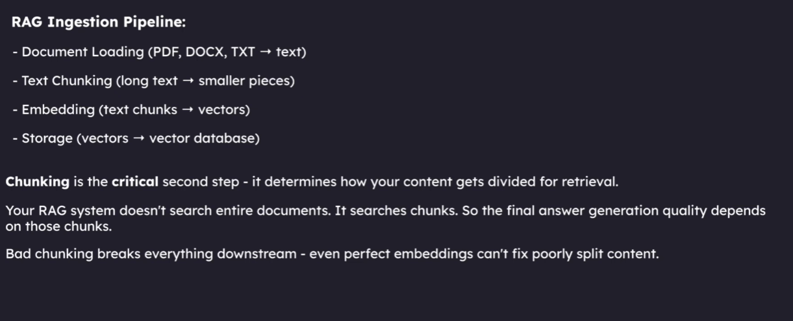
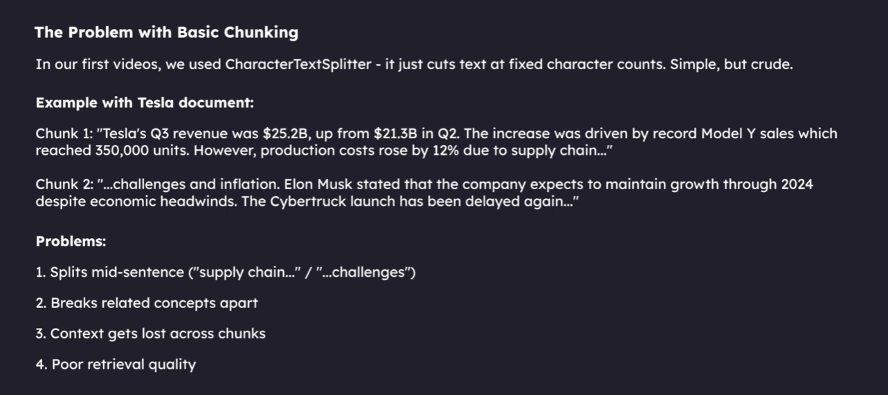
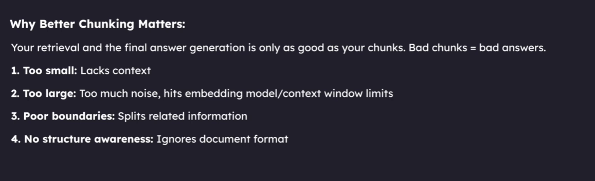
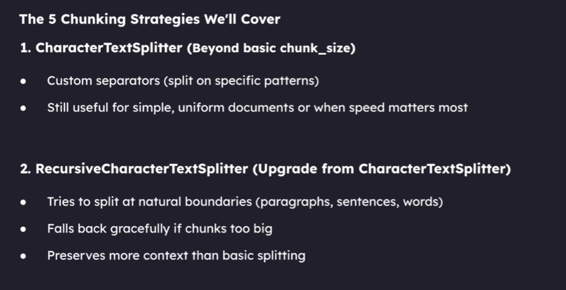
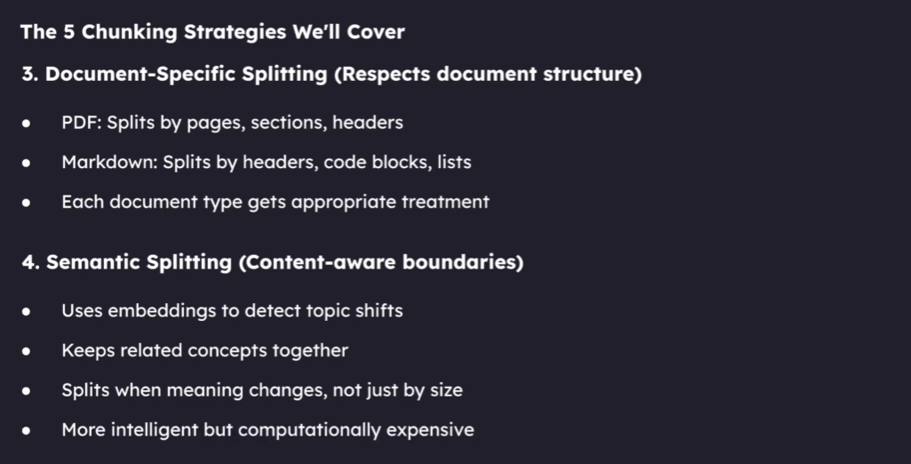
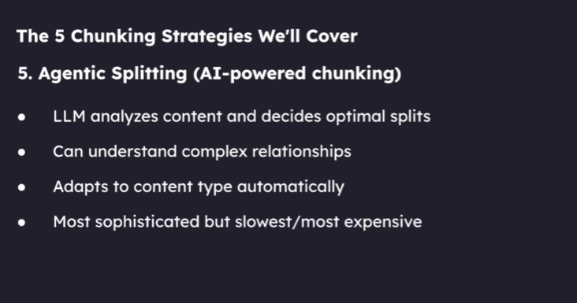

# RAG Chunking Strategies

This guide explains how to split long documents into useful pieces for a
Retrieval-Augmented Generation (RAG) system. It uses simple English, examples,
and diagrams.

## 1. What is chunking?

Imagine a book is too big to hand to a helper every time you ask a question.
Instead, you cut the book into smaller pages or flashcards. In RAG, these
smaller pieces are called **chunks**.

The computer searches the chunks, finds the ones that seem useful, and gives
them to the language model (LLM) so it can answer your question.



Chunking is part of the **ingestion pipeline**:

1. **Load** documents, such as text files.
2. **Split** their contents into chunks.
3. **Embed** each chunk by turning its meaning into a list of numbers.
4. **Store** the chunks and their embeddings in a vector database.
5. Later, search those chunks when a user asks a question.

The answer can only be as helpful as the pieces the search finds. If the useful
sentence was cut away from the words that explain it, the LLM may not have
enough information to answer correctly.

## 2. Why not send the whole document?

A complete book may be too long, slow, or expensive to send to an LLM for every
question. Searching smaller pieces helps the system find just the parts that
matter.

Chunking also has to avoid making pieces that are unhelpful:

- **Too small:** a chunk may not explain who or what a sentence is about.
- **Too large:** it may contain lots of unrelated details and use more of the
  model's input space.
- **Cut in the wrong place:** a definition may be separated from its example.
- **No document structure:** a heading, table, or code block may lose its
  relationship to nearby text.





### A small example

Suppose a document says:

> The solar system has eight planets. They orbit the Sun. The four inner
> planets are rocky worlds.

If a chunk contains only **"They orbit the Sun"**, a search result may not tell
the LLM what "they" means. A better chunk keeps the first sentence with the
second one.

## 3. Important chunking words

- **Character:** one letter, number, space, or punctuation mark.
- **Token:** a small piece of text that an LLM reads. Tokens are not always the
  same as words or characters.
- **Chunk size:** the target maximum size of one text piece, measured using the
  unit the splitter is configured to count.
- **Chunk overlap:** text repeated at the end of one chunk and the start of the
  next. It can preserve a little context across a split.
- **Separator:** a boundary used to split text, such as a paragraph break or
  newline.
- **Metadata:** extra information attached to a chunk, such as its source file,
  page, or section.

The size unit matters. In this project's current ingestion script,
`chunk_size=800` is a character count, not a promise of 800 LLM tokens.

## 4. The five strategies

The diagrams below introduce five ways to decide where one chunk ends and the
next begins. They are different tools for different kinds of documents; there
is no one strategy that is best for every project.







### Strategy 1: Character splitting

**Simple idea:** split text using one chosen separator, then join nearby pieces
until they fit the target size.

For example, the separator might be a paragraph break. This is straightforward
and can work for short, consistently formatted documents.

**Good points**

- Simple to understand and configure.
- Fast for a small project.
- A useful starting point when learning RAG.

**Things to watch**

- It does not understand what the sentences mean.
- A long section between separators may be larger than the target.
- With a zero overlap, a fact near the edge of a chunk may lose nearby context.

### Strategy 2: Recursive character splitting

**Simple idea:** try larger, more natural boundaries first, then smaller ones
if a section is still too long. A typical order is paragraph, line, word, and
finally character.

This is like trying to cut a book at chapter boundaries first. If a chapter is
too large, try sections; if a section is too large, try paragraphs.

**Good points**

- Usually keeps sentences and paragraphs together better than one fixed
  separator.
- Can fall back to smaller boundaries for unusually long sections.
- A common general-purpose choice for ordinary text.

**Things to watch**

- It still does not truly understand meaning or topic changes.
- A chunk may still contain unrelated ideas if the source text is poorly
  organized.

### Strategy 3: Document-specific splitting

**Simple idea:** use the structure of the document instead of treating every
file as plain text.

Examples:

- **Markdown:** split around headings, while keeping each section's heading
  with its text.
- **PDF:** use page and layout information when it is available.
- **Code:** split by classes and functions rather than breaking in the middle
  of a function.
- **Tables:** keep a table's headings with its rows.

**Good points**

- Preserves useful relationships that already exist in the source.
- Helps the LLM know which topic or section a chunk belongs to.

**Things to watch**

- Different formats need different loaders and splitting rules.
- A PDF may not contain clean structural information, even if it looks nicely
  formatted on screen.

### Strategy 4: Semantic splitting

**Simple idea:** compare the meanings of nearby sentences and create a split
when the topic changes.

For example, several sentences about planets might stay together. If the next
sentences begin talking about computer history, the system may start a new
chunk there.

**Good points**

- Can keep related ideas together even when paragraph boundaries are not
  helpful.
- Uses meaning rather than only character counts.

**Things to watch**

- Needs an embedding model and extra computation.
- Similarity thresholds need testing and tuning.
- It can be slower or more expensive than simple splitting.

### Strategy 5: Agentic splitting

**Simple idea:** ask an LLM to inspect content and suggest where the chunks
should be split.

This can help with complicated material, but the model's choices can vary and
need checking.

**Good points**

- Can consider complex structure and relationships.
- Can adapt its decisions to different types of content.

**Things to watch**

- More model calls mean more time and cost.
- The result may be inconsistent or incorrect.
- Usually needs safeguards, validation, and a reason to justify the extra
  complexity.

## 5. Choosing chunk size and overlap

There is no magic chunk size that is perfect for every document. Try a few
settings using real questions people will ask.

### If chunks are too small

- Pronouns and explanations may be separated from their subject.
- The LLM may receive too little information to answer.
- Search may find many tiny pieces instead of one useful explanation.

### If chunks are too large

- Search may return a lot of unrelated text.
- Important details can be harder to identify.
- More text is sent to the LLM, which can increase latency and usage.

### What overlap does

Overlap repeats some text between neighboring chunks. If one chunk ends in the
middle of a topic, the next chunk can repeat a little of that topic so the
boundary does not remove all context.

Overlap is not free: it creates repeated text in the database and search
results. Start with a small overlap only when testing shows that useful context
is being lost at chunk edges.

## 6. What this project currently does

The project's [`1_ingestion_pipeline.py`](./1_ingestion_pipeline.py) currently
uses `CharacterTextSplitter`:

```python
def split_docs(documents, chunk_size=800, chunk_overlap=0):
    text_splitter = CharacterTextSplitter(
        chunk_size=chunk_size,
        chunk_overlap=chunk_overlap,
    )
    chunks = text_splitter.split_documents(documents)
    return chunks
```

In simple terms:

1. `documents` is the text loaded from the files in the `docs` folder.
2. `chunk_size=800` sets the target size to 800 characters for this splitter.
3. `chunk_overlap=0` means neighboring chunks do not intentionally repeat text.
4. `split_documents` makes smaller document objects and keeps their metadata.
5. Those chunks are then embedded and stored in Chroma by the next step of the
   ingestion pipeline.

This is a good basic learning setup. It is not semantic or agentic chunking.
If you change the splitting strategy, rerun ingestion so Chroma stores chunks
made with the new rules. The existing database does not automatically change
when the Python code changes.

## 7. A practical way to improve chunking

1. **Start simple.** Use a splitter that matches the document format.
2. **Write test questions.** Include direct questions and follow-ups.
3. **Inspect retrieved chunks.** Check whether the chunk contains the answer
   and enough surrounding explanation.
4. **Change one setting at a time.** Try a different size, overlap, or
   separator.
5. **Compare results.** Check answer correctness, retrieval quality, speed,
   and cost.
6. **Rebuild the vector database** after changing ingestion or chunking rules.
7. **Choose the simplest strategy** that gives reliable answers for your
   documents.

## 8. Quick summary

| Strategy | Best starting use | Main trade-off |
|---|---|---|
| Character | Simple, consistently formatted text | Does not understand document meaning |
| Recursive character | General-purpose text | Respects boundaries better, but is not semantic |
| Document-specific | Markdown, PDFs, code, tables | Needs format-aware loading and rules |
| Semantic | Text with topic changes inside sections | Better meaning awareness, more computation |
| Agentic | Complex content where adaptive decisions matter | More cost, latency, and validation |

Chunking is like choosing how to cut a big story into flashcards. Good cuts
keep each idea understandable. The best strategy is the one that helps your
system find complete, useful information for the questions your users
actually ask.
