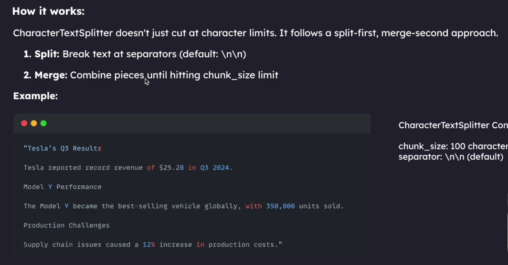
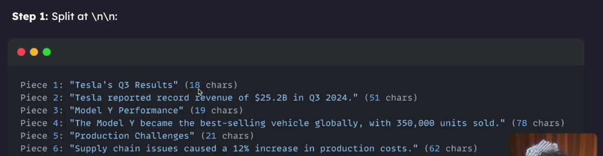
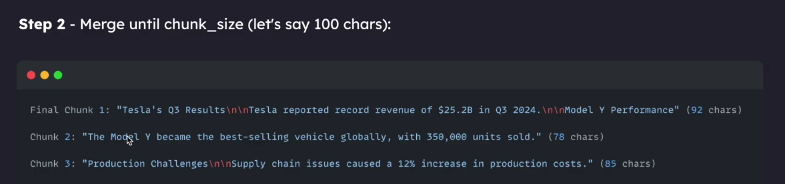
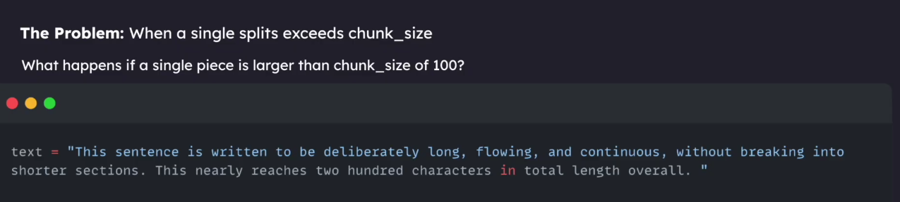

# CharacterTextSplitter: Explained So Simply Even a 5-Year-Old Can Understand!

> **"Imagine you have a giant 10-foot sandwich. Can you swallow it whole? No way! Your tummy is small! You must cut it into bite-sized snacks."**
>
> In the world of Artificial Intelligence (AI) and **RAG (Retrieval-Augmented Generation)**, a computer's "tummy" (memory window) cannot swallow an entire 500-page book in one go. We have to chop the book into small, tasty snack bites called **Chunks**.
>
> This guide explains the simplest chunker in LangChain: **`CharacterTextSplitter`** — how it works, its hidden secrets, its big flaw, and how the pictures in this folder explain the whole story!

---

## Table of Contents
1. [The 5-Year-Old Story: The Giant Chocolate Bar & The Lunchboxes](#1-the-5-year-old-story-the-giant-chocolate-bar--the-lunchboxes)
2. [What is CharacterTextSplitter?](#2-what-is-charactertextsplitter)
3. [The 2-Step Magic Trick: Split First, Merge Second](#3-the-2-step-magic-trick-split-first-merge-second)
4. [Step 1 in Action: Snapping at Double Enters (`\n\n`)](#4-step-1-in-action-snapping-at-double-enters-nn)
5. [Step 2 in Action: Packing the Lunchboxes (Max 100 Letters)](#5-step-2-in-action-packing-the-lunchboxes-max-100-letters)
6. [The Giant Cookie Trap: Where CharacterTextSplitter Fails!](#6-the-giant-cookie-trap-where-charactertextsplitter-fails)
7. [The Solution: Why We Need Backup Scissors (`RecursiveCharacterTextSplitter`)](#7-the-solution-why-we-need-backup-scissors-recursivecharactertextsplitter)
8. [Hands-On Python Code: Run It Yourself](#8-hands-on-python-code-run-it-yourself)
9. [Quick Memory Card: Summary](#9-quick-memory-card-summary)

---

## 1. The 5-Year-Old Story: The Giant Chocolate Bar & The Lunchboxes

Imagine your mommy gives you a giant chocolate bar with lots of writing on it.

```text
[ Giant 500-Letter Story ]  ----->  Cannot fit in your pocket! ❌
         |
         v (Chop Chop!)
[Chunk 1: 92 letters]    [Chunk 2: 78 letters]    [Chunk 3: 85 letters]  -----> Fits perfectly in your pocket! ✅
```

- If you try to stuff the entire chocolate bar into your tiny pocket, it breaks and makes a giant mess.
- So, you get **small toy lunchboxes**.
- Each lunchbox can only hold a maximum of **100 letters** (`chunk_size = 100`).
- You also have a special rule: You don't want to cut words right through their middle (nobody wants to read `Dino-` in one box and `-saur` in another!).
- You only want to cut where there is a **big empty space between paragraphs** (`\n\n`, which means pressing Enter twice on your keyboard).

This helpful robot friend who does this packing for you is called **`CharacterTextSplitter`**!

---

## 2. What is CharacterTextSplitter?

`CharacterTextSplitter` is a tool from **LangChain** that divides big documents into smaller chunks based on a specific character separator.

### The 3 Magic Knobs You Can Turn:
| Knob Name | What It Means to a 5-Year-Old | Default Value |
| :--- | :--- | :--- |
| **`separator`** | The secret mark where your scissors are allowed to cut. | `"\n\n"` (Double Enter / paragraph break) |
| **`chunk_size`** | The maximum size of each lunchbox (count of letters/characters). | `4000` (often set to `100` or `500` for tests) |
| **`chunk_overlap`** | A little bit of repeated text copied from the previous box so you don't forget what was just said. | `200` (can be `0` or `20`) |

---

## 3. The 2-Step Magic Trick: Split First, Merge Second

Most people think: *"Oh, character splitter means it just counts 1, 2, 3... 100 letters and chops!"*  
**NOPE! That is a big misconception!**

`CharacterTextSplitter` does NOT just count 100 letters and snip blindly. It follows a very specific two-step dance:

1. **SPLIT FIRST:** It takes giant safety scissors and cuts ONLY at the separator (by default `\n\n`). Now it has a pile of loose paragraphs or pieces.
2. **MERGE SECOND:** It takes those pieces and packs them into the lunchbox one by one until the lunchbox is close to full (reaching the `chunk_size` limit). When the next piece won't fit, it closes that lunchbox and starts a new one!



### The Example Document:
Look at the text in the picture above:
```text
"Tesla's Q3 Results

Tesla reported record revenue of $25.2B in Q3 2024.

Model Y Performance

The Model Y became the best-selling vehicle globally, with 350,000 units sold.

Production Challenges

Supply chain issues caused a 12% increase in production costs."
```

Settings used:
- **`chunk_size`**: `100` characters
- **`separator`**: `"\n\n"` (default)

---

## 4. Step 1 in Action: Snapping at Double Enters (`\n\n`)

In Step 1, the splitter ignores `chunk_size` for a moment. It looks through the document and finds every `\n\n` (blank line). Every time it sees `\n\n`, **SNIP!**



Now we have **6 separate building blocks (Pieces)**:

| Piece # | Content of the Piece | Length (Characters) |
| :---: | :--- | :---: |
| **Piece 1** | `"Tesla's Q3 Results"` | **18** |
| **Piece 2** | `"Tesla reported record revenue of $25.2B in Q3 2024."` | **51** |
| **Piece 3** | `"Model Y Performance"` | **19** |
| **Piece 4** | `"The Model Y became the best-selling vehicle globally, with 350,000 units sold."` | **78** |
| **Piece 5** | `"Production Challenges"` | **21** |
| **Piece 6** | `"Supply chain issues caused a 12% increase in production costs."` | **62** |

None of the sentences got chopped in half! Every paragraph is intact. Now it's time for Step 2!

---

## 5. Step 2 in Action: Packing the Lunchboxes (Max 100 Letters)

Now the packer robot brings out the empty lunchboxes. The capacity of each box is **100 characters**.



Let's watch the robot pack the pieces step-by-step:

### 🍱 Packing Box 1 (Chunk 1):
1. Put in **Piece 1** (18 chars).  
   *Current total:* 18. Can we add more? Yes!
2. Put in separator + **Piece 2** (51 chars).  
   *Current total:* 18 + 2 (`\n\n`) + 51 = 71 chars. Still under 100!
3. Put in separator + **Piece 3** (19 chars).  
   *Current total:* 71 + 2 (`\n\n`) + 19 = **92 chars**.
4. Can we add **Piece 4** (78 chars)?  
   `92 + 2 + 78 = 172 chars`.  
   **STOP! That is greater than 100! Box 1 is full!**
5. **Final Chunk 1 is sealed:**
   ```text
   "Tesla's Q3 Results\n\nTesla reported record revenue of $25.2B in Q3 2024.\n\nModel Y Performance"
   Total Length: 92 characters
   ```

---

### 🍱 Packing Box 2 (Chunk 2):
1. Robot opens an empty Box 2.
2. Put in **Piece 4** (78 chars).  
   *Current total:* 78 chars.
3. Can we add separator + **Piece 5** (21 chars)?  
   `78 + 2 + 21 = 101 chars`.  
   **STOP! 101 is bigger than 100! It won't fit!**
4. **Final Chunk 2 is sealed:**
   ```text
   "The Model Y became the best-selling vehicle globally, with 350,000 units sold."
   Total Length: 78 characters
   ```

---

### 🍱 Packing Box 3 (Chunk 3):
1. Robot opens an empty Box 3.
2. Put in **Piece 5** (21 chars).  
   *Current total:* 21 chars.
3. Put in separator + **Piece 6** (62 chars).  
   *Current total:* 21 + 2 (`\n\n`) + 62 = **85 chars**.
4. No more pieces left in the pile!
5. **Final Chunk 3 is sealed:**
   ```text
   "Production Challenges\n\nSupply chain issues caused a 12% increase in production costs."
   Total Length: 85 characters
   ```

**Result:** 3 clean, beautiful chunks! None of them broke words, and each stayed under 100 characters!

---

## 6. The Giant Cookie Trap: Where CharacterTextSplitter Fails!

Now comes the twist in our story! What happens if someone gives you a **giant cookie** that is 200 characters long, and has **NO double enters (`\n\n`)** inside it?



Look at this sentence:
```python
text = (
    "This sentence is written to be deliberately long, flowing, and continuous, "
    "without breaking into shorter sections. This nearly reaches two hundred characters in total length overall. "
)
```

In this sentence, the total number of letters is almost **200 characters**, but our box limit (`chunk_size`) is only **100**!

### What Does CharacterTextSplitter Do?


Here is the secret flaw of `CharacterTextSplitter`:
- The robot promised: *"I will ONLY cut at `\n\n`!"*
- It looks for `\n\n` in that long sentence.
- It finds **ZERO** `\n\n`!
- The robot does NOT know how to cut at spaces `" "` or periods `"."`.
- It gets confused, shrugs its shoulders, and stuffs the entire 200-character sentence into the 100-size box anyway!

> [!WARNING]
> **The Infamous LangChain Warning:**  
> When this happens, Python prints this exact warning to your terminal:  
> `Created a chunk of size 198, which is longer than the specified 100`  
>  
> `CharacterTextSplitter` **violates your chunk_size limit** because it refuses to cut anywhere except at the designated separator!

---

## 7. The Solution: Why We Need Backup Scissors (`RecursiveCharacterTextSplitter`)

Because `CharacterTextSplitter` is stubborn and can overflow when paragraphs are too long, engineers invented a smarter older brother: **`RecursiveCharacterTextSplitter`**.

Think of `RecursiveCharacterTextSplitter` as having a whole toolbox of backup scissors:
1. First, try cutting at `"\n\n"` (Double Enter).
2. If a piece is still too big (> `chunk_size`), use the next scissors: `"\n"` (Single Enter).
3. If it's still too big, use the next scissors: `" "` (Space between words).
4. If a single word is still too big, cut individual characters `""`.

That is why in production RAG systems, people usually prefer `RecursiveCharacterTextSplitter`!

---

## 8. Hands-On Python Code: Run It Yourself

You can test this yourself right now using the script in this repository: [5_charecter_textSplitter.py](file:///home/supain/SupainNandy/RAG--Retrieval-Augmented-Generation/5_charecter_textSplitter.py).

```python
from langchain_text_splitters import CharacterTextSplitter

# 1. The document with paragraph breaks (\n\n)
sample_text = """Tesla's Q3 Results

Tesla reported record revenue of $25.2B in Q3 2024.

Model Y Performance

The Model Y became the best-selling vehicle globally, with 350,000 units sold.

Production Challenges

Supply chain issues caused a 12% increase in production costs."""

# 2. Set up the splitter
splitter = CharacterTextSplitter(
    separator="\n\n",
    chunk_size=100,
    chunk_overlap=0
)

# 3. Create the chunks
chunks = splitter.split_text(sample_text)

# 4. Print each chunk
print(f"Total Chunks Created: {len(chunks)}\n")
for index, chunk in enumerate(chunks, start=1):
    print(f"=== Chunk {index} (Length: {len(chunk)}) ===")
    print(repr(chunk))
    print()
```

### Output:
```text
Total Chunks Created: 3

=== Chunk 1 (Length: 92) ===
"Tesla's Q3 Results\n\nTesla reported record revenue of $25.2B in Q3 2024.\n\nModel Y Performance"

=== Chunk 2 (Length: 78) ===
'The Model Y became the best-selling vehicle globally, with 350,000 units sold.'

=== Chunk 3 (Length: 85) ===
'Production Challenges\n\nSupply chain issues caused a 12% increase in production costs.'
```

---

## 9. Quick Memory Card: Summary

| Concept | Explanation for a 5-Year-Old |
| :--- | :--- |
| **What is Chunking?** | Cutting a huge storybook into small pocket-sized cards so the AI doesn't choke. |
| **CharacterTextSplitter** | A cutter tool that only knows how to cut at **one specific separator** (default `\n\n`). |
| **Split-First, Merge-Second** | First snip all `\n\n` marks, then pack pieces together until hitting `chunk_size`. |
| **Why does it overflow?** | If a single sentence without `\n\n` is bigger than `chunk_size`, it won't cut it and will exceed the limit! |
| **Where are the images stored?** | All diagrams and visual slides are organized inside `images/character_text_splitter/`! |
